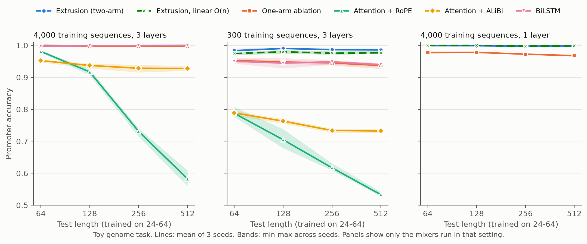
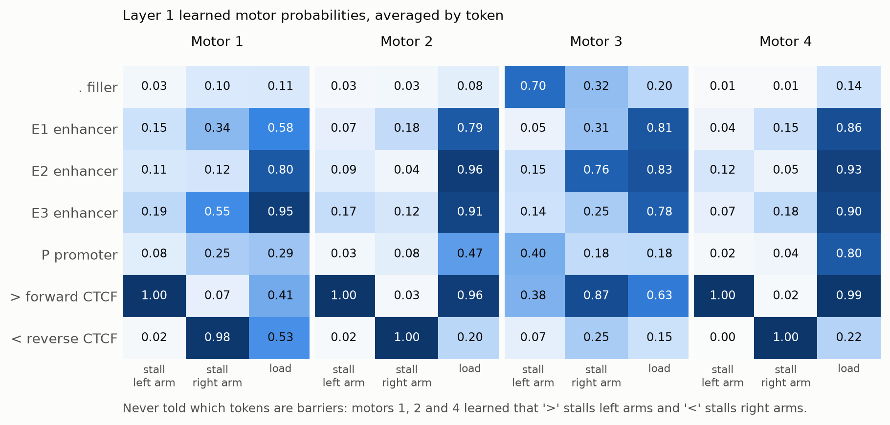
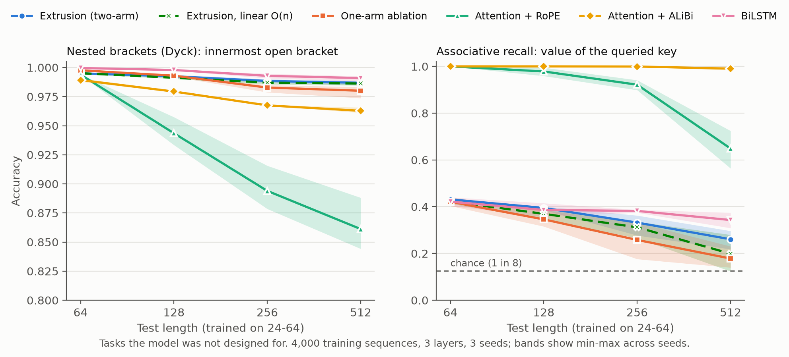

# Extrusion Net

[](https://github.com/aarnavbhat23/extrusion-net/actions/workflows/reproduce.yml)

**Measured-data update:** a [frozen single-molecule encounter screen](docs/MEASURED_ENCOUNTER_RESULTS.md)
now tests 203 encounters from 167 molecule identifiers across eight held-out
experimental batches. The loop-size/elapsed-time candidate is **11.3% worse**
than the published exponential force-law family in mean log loss and fails its
continuation gate. Full ordered trajectories are needed before claiming learned
history-dependent dynamics; the current public encounter summaries do not
establish that mechanism.

**Can a model learn directional transport from a few controlled probes?**

**A length-independent number of controlled vector responses globally identifies
every directional gate**, for known loading, source-invariant unsaturated
transport and any fixed pass-probability ceiling below one. The
[recovery theorem](docs/COLORED_RECOVERY.md) gives a globally convergent matrix-free
iteration and a computable noise-error bound. The sufficient response budget
grows with transparency: 14/24/86/492 responses at ceilings .2/.5/.8/.95.
A [four-response theorem](docs/DETERMINISTIC_PROBES.md) applies when every gate
is below approximately .087. All proofs, assumptions and costs are explicit.

The recovery study tests 60 mechanisms at 32/128/512 loads, with noiseless and
noisy responses, plus near-transparent stress cases and held-out gate cuts.
A constructed source-dependent mechanism matches every calibration response but
fails on a new source. A held-out validation test detects larger shifts and
misses smaller ones: identifying a fixed mechanism does not establish its
invariance across untested inputs.

The [earlier loading-probe study](docs/LOAD_PROBES.md) derives exact local gate
recovery from two known source patterns and fits a shared controller from 68
noisy response scalars. It retains the strong random-loading control and its
wins. These results concern mechanism recovery and synthetic transfer; general
task-learning advantages remain unestablished. The linear operator belongs to
a known structured-matrix family, and color probing has established precedent.

A [finite-lifetime transfer screen](docs/KINETIC_TRANSFER.md) now exposes a
physical-model boundary: independent arm lifetimes preserve recovery, while a
shared removal clock causes held-out prediction failures. The shared-clock
family has an exact arbitrary-rank cross-block witness, placing it beyond the
existing fixed-state linear scan. A clean local-band identity identifies the
clock under its stated assumptions; noisy identification and measured-data
transfer remain open. All failures and extra measurement costs are retained.

The [noisy clock-recovery follow-up](docs/CLOCK_IDENTIFICATION.md) reduces
held-out message RMSE from .04346 to .00202 at band noise SD .001 under the
shared-clock family, with conservative uncertainty bounds and retained mismatch
failures. A [causal shared-clock learning prototype](docs/CAUSAL_CLOCK_RESULTS.md)
failed its matched architectural screen; its additional cost did not solve
content retrieval. These identification and learning outcomes are separate.

A [content-retrieval follow-up](docs/MOMENT_MEMORY_RESULTS.md) specifies a
query-conditioned value-moment read and tests 21 operator runs plus 12 causal
text runs. **It fails the frozen continuation gate:** recall falls from 98.4%
at eight bindings to 72.4% at 32, and text quality is unchanged at substantially
higher cost. Positive writes can only enlarge its compatible-value set, explaining
the loss of certification. This is retained negative evidence, not an architecture
advance; its conditional atom check cannot establish key presence.

The [asynchronous-transfer study](docs/ASYNCHRONOUS_RESULTS.md) proves that two
timing mechanisms can match every distance-two/three observation yet disagree
under interventions. A distance-four band resolves this ambiguity and reduces
moderate-noise held-out error threefold in the development screen. The same
three bands identify unequal step/removal rate ratios under a continuous-time
reach model. That extra flexibility fails its moderate-noise improvement gate;
measured biological transfer and general sequence-learning gains remain open.

An [independent event-engine study](docs/EXTERNAL_ENGINE_RESULTS.md) now tests
the restricted reach model in unmodified `lefsim`: 18/18 matched cases pass and
6/6 tested mismatches reject, with simultaneous sampling-error accounting.
This is simulator transfer with known gate locations and a controlled source.
[dLEM already provides learnable loop-extrusion models](docs/BIOLOGICAL_NOVELTY_AUDIT.md);
architecture novelty and experimental chromatin prediction remain unestablished.

A [common-observable follow-up](docs/OCCUPANCY_RESULTS.md) now maps the unchanged
authors' dLEM forward to controlled random-delay anchor snapshots. It agrees
exactly with our memoryless Markov recurrence. Retaining hidden capture states
reduces median intervention RMSE by 1.93× across 21 simulator cases, just below
the frozen 2× gate. A finite-bank acquisition rule also fails its cost gate and
excludes off-grid targets. [Continuous-domain enclosures](docs/CONTINUOUS_OCCUPANCY_RESULTS.md)
retain all six fresh generating mechanisms but miss useful precision. A survival
identity tightens them; independently checked feasible pairs still disagree by
3.0–4.7 points on intervention absence while satisfying every chosen calibration
constraint. These are conditional mechanistic diagnostics, not a new learning
paradigm, general dLEM superiority or measured biological validation.

Related results: [fixed-source ambiguity](docs/IDENTIFIABILITY.md),
[inconsistent noisy intervention selection](docs/NOISY_IDENTIFICATION_RESULTS.md),
[calibration stability](docs/STABLE_CALIBRATION.md), and
[sharp single-mixer output bounds](docs/COUNTERFACTUAL_OUTPUT_BOUNDS.md).

## Original prediction study

Can a neural network route information the way chromatin does?

In the nucleus, cohesin motors load onto DNA and reel it into loops from both sides. Each side stalls at a CTCF protein facing the right way, so a forward site (`>`) followed by a reverse site (`<`) anchors a loop that insulates genes from enhancers outside it. This repository turns that process into a sequence model's only long-range operator. Every position predicts, from its local context alone, how likely a motor is to load there and how likely each arm is to stall there. Two positions exchange information only if a simulated motor brings them into the same loop. There is no positional encoding and no query-key product.

On a toy genome task that follows the convergent-CTCF rule, the extrusion model trained on 4,000 sequences **keeps 99.8-100% accuracy at 8x its longest training sequence**. RoPE attention falls to 58%. With **300 training sequences** it reaches **98.4-99.0%**, while BiLSTM and the one-arm ablation reach 93.7-95.3% and attention 53-79%. Without being told which tokens are barriers, it **learned the CTCF orientation rule**.

Outside genomics, it **generalizes on nested brackets** (98.7% at 512; BiLSTM 99.1%, attention 86-96%), but it **cannot look things up by content**: on associative recall it falls toward chance, as BiLSTM does, while ALiBi attention stays at 99%. Its linear part is a known structured-matrix type (2-quasiseparable), which gives an **O(n) version**: within 0.9 points of the full model, with a standalone recurrence measured at 65,536 positions. The complete unsaturated mixer now executes through the scan in both forward and backward; see the [execution and control study](results/SCAN_RESULTS.md).



## What happened

36 runs: five long-range mixers on one shared backbone, 3 seeds each. Promoter accuracy, mean of 3 seeds; all models trained on lengths 24-64 only.

| Mixer | Params | 4,000 seqs, len 64 | 4,000 seqs, len 512 | 300 seqs, len 64 | 300 seqs, len 512 |
|---|---:|---:|---:|---:|---:|
| Extrusion (two-arm) | 141,428 | **1.000** | **1.000** | **0.984** | **0.986** |
| One-arm ablation | 141,428 | 0.998 | 0.997 | 0.953 | 0.937 |
| Attention + RoPE | 163,268 | 0.981 | 0.582 | 0.787 | 0.533 |
| Attention + ALiBi | 163,268 | 0.952 | 0.928 | 0.789 | 0.732 |
| BiLSTM | 188,612 | 0.997 | **1.000** | 0.950 | 0.940 |

With **one layer** (4,000 sequences), two-arm extrusion scores 0.998 at length 512 and the one-arm ablation 0.968. It wins on all 3 seeds at every length. All lengths, seed ranges and the 1-layer table are in [`results/RESULTS.md`](results/RESULTS.md).

1. **Length generalization.** Extrusion and BiLSTM stay near-perfect at 512. RoPE attention collapses; ALiBi plateaus around 93%.
2. **Sample efficiency.** With 300 sequences, at every test length, extrusion's worst seed beats every other model's best seed.
3. **The two-arm mechanism matters.** One extrusion layer can represent the convergent rule exactly ([proof](docs/DERIVATION.md#exactness-for-the-convergent-ctcf-rule)); one one-arm layer cannot. With 3 layers the ablation catches up through depth.
4. **With enough data, it ties BiLSTM.** The rule can be checked by a left-to-right scan, which suits recurrent models. Extrusion's advantage over BiLSTM here is the measured inductive bias and data efficiency; the current scan uses sequential Python recurrences.

## What the model learned



The model only ever saw promoter labels. In the released checkpoint, three of four first-layer motors learned that `>` stalls left-moving arms (0.995-0.999) but not right-moving ones (0.019-0.068). They also learned that `<` stalls right-moving arms (0.985-0.999) but not left-moving ones (0.005-0.023). That is the orientation rule found experimentally in real genomes. Loading is high at enhancers in all four motors (0.58-0.96), and in motors 2 and 4 also at forward sites (0.96-0.99). Motor 3 learned something else. Only this one checkpoint was inspected.

## Beyond the genome task

Two tasks the model was not designed for, with the same backbone, lengths, seeds and training. The rules for reading them were committed before any run finished ([`docs/PROTOCOL.md` §8](docs/PROTOCOL.md#8-generality-and-linear-variant-experiments-rules-written-before-any-result)).



| Mixer | Dyck, len 64 | Dyck, len 512 | Recall, len 64 | Recall, len 512 |
|---|---:|---:|---:|---:|
| Extrusion (two-arm) | 0.995 | 0.987 | 0.431 | 0.261 |
| Extrusion, linear O(n) | 0.995 | 0.986 | 0.422 | 0.199 |
| One-arm ablation | 0.998 | 0.980 | 0.421 | 0.178 |
| Attention + RoPE | 0.994 | 0.861 | **1.000** | 0.649 |
| Attention + ALiBi | 0.989 | 0.963 | **1.000** | **0.990** |
| BiLSTM | **1.000** | **0.991** | 0.421 | 0.343 |

- **Nested brackets (Dyck).** Each position must report the innermost open bracket, which often means skipping over matched pairs; simple rules score about 70%. Extrusion stays at 98.7% at 512, above both attention variants and the one-arm ablation but 0.4 points below BiLSTM. Under the committed rule, that counts as a limitation. Broken down by how deeply nested the skipped material is (`analyze_dyck.py`), every model is near-perfect through depth 1. Extrusion then falls to 95.5% at depth 3 and 76.1% at depth 5; BiLSTM falls to 99.0% and 85.1%. My guess that each layer peels off one level was wrong: a 6-layer extrusion model barely moved (95.7% and 80.9%). Deep skips are rare in the short training sequences (0.6% of training positions at depth 5 vs 2.1% at test), so the gap is at least partly data coverage. The next mechanism, loop traversal ([`docs/ROADMAP.md`](docs/ROADMAP.md), A2), should therefore be tested by training on shallow nesting and testing on deeper nesting.
- **Associative recall.** Answering a query means finding the matching key anywhere earlier, which is lookup by content. Extrusion, its linear version, the one-arm ablation and BiLSTM all fall toward chance (12.5%) at length 512. ALiBi attention stays at 99%. This is the scope boundary: extrusion decides *which positions can reach each other*, not *which content matches*. It points toward pairing extrusion with a content mechanism ([`docs/ROADMAP.md`](docs/ROADMAP.md), A3).

## Linear-time version

Without the saturation step, the contact matrix factors as `L diag(l) R`: two one-sided transports chained through the load gate. Every separated block strictly above the diagonal has rank at most 2, so the matrix is 2-quasiseparable. That is the same structured-matrix family used by bidirectional state-space models such as Hydra and Mamba-2, and it means mixing can be done with four linear scans instead of an n x n matrix ([derivation](docs/DERIVATION.md#structured-matrix-view-and-an-on-algorithm)).

- **Accuracy.** The unsaturated `extrusion_linear` matches full extrusion with one layer (0.999 vs 0.998 at length 512) and is 0.90 points lower with 300 training sequences (0.977 vs 0.986). That is still above BiLSTM (0.940) and the one-arm ablation (0.937). It passes the 1-point rule committed beforehand.
- **Scale.** `bench_scaling.py` mixes 65,536 positions in 2.0 seconds on one CPU thread with a plain Python loop. The dense matrix at that length would need 16 GB; up to 4,096 positions, where both run, the two agree within 4e-5 relative error ([`results/scaling.json`](results/scaling.json)).

## The mechanism

For positions `i < j`, with load propensity `l`, left-arm stall `sL` and right-arm stall `sR`:

```
D(i, j) = sum_{k=i+1..j} l_k * prod_{m=i+1..k-1} (1 - sL_m) * prod_{m=k..j-1} (1 - sR_m)
W(i, j) = 1 - exp(-beta * D(i, j))
```

Position `i` receives `sum_j W(i, j) v_j`. Prefix sums make this exact in O(n^2), the same order as attention; without saturation it is O(n) (above). The derivation, numerics, exactness proof and structured-matrix view are in [`docs/DERIVATION.md`](docs/DERIVATION.md).

## Reproduce

Python 3.13 or 3.14 on a CPU. The recorded runs used an Apple M3, 2 threads per run.

```bash
python -m venv .venv
source .venv/bin/activate
python -m pip install -r requirements.txt -r requirements-external.txt
python dlem_comparator.py
python -m unittest discover -s tests -v
python replay.py
python predict.py "3..P..>..<..2..P"
```

`replay.py` reloads the released checkpoint and checks its recorded test accuracy and learned orientation motors. `predict.py` takes any string of `. 1 2 3 P > <` and reports each promoter's prediction next to the rule. To rerun experiments:

```bash
python train.py --mixer extrusion --seed 0                         # one row of the grid, about 10 CPU minutes
python train.py --mixer one_arm --seed 0 --layers 1                # 1-layer setting
python train.py --mixer bilstm --seed 0 --n-train 300              # low-data setting
python train.py --task dyck --mixer extrusion_linear --seed 0      # generality tasks: dyck, recall
python summarize.py && python inspect_learned.py && python plot.py
python bench_scaling.py                                            # isolated recurrence
python bench_mixer.py                                              # complete forward/backward scaling
python audit_scan_pilot.py                                         # replay all nine short-pilot checkpoints
python study_polynomial.py                                         # bounded saturation-approximation check
```

Mixers: `extrusion`, `extrusion_linear`, `cascaded_scan`, `one_arm`, `attn_rope`, `attn_alibi`, `bilstm`. Tasks: `genome` (default), `dyck`, `recall`. Every run appends one line to `results/runs.jsonl`.

## Protocol

Task, splits, seeds, models, training and selection are specified in [`docs/PROTOCOL.md`](docs/PROTOCOL.md). In short: tokens `. E1 E2 E3 P > <` are sampled independently. Each promoter's label is the strongest enhancer (0-3) not insulated from it by a `>` preceding a `<`. Train lengths are 24-64; test lengths are 64, 128, 256 and 512. Checkpoints are selected on in-distribution validation only. All five mixers share the embedding, convolution, MLP and head.

That document also says which choices were made after seeing results. The 1-layer and 300-sequence settings were added because the first grid saturated. The released checkpoint was retrained for inspection, so its numbers differ slightly from the grid's seed-0 row.

## Artifacts

- `results/runs.jsonl`: all 78 runs (36 genome, 42 generality and linear-variant), with validation curves.
- `results/scaling.json`: dense vs O(n) timing and agreement.
- `results/checkpoints/dyck_*_s0.pt`, `results/dyck_skip_depth*.json`: seed-0 Dyck checkpoints (3 and 6 layers, retrained with `--save`) and their accuracy by nesting depth from `analyze_dyck.py`.
- `results/RESULTS.md`: per-setting tables with seed ranges.
- `results/extrusion_seed0.pt`: released extrusion checkpoint.
- `results/replay.json`: its recorded test accuracy and layer-1 orientation motors.
- `results/motors.json`, `results/inspect.txt`: learned stall and load probabilities by token, all layers.
- `results/*.png`, `results/*.svg`: figures from `plot.py`.

## Prior work and credit

Loop extrusion and the convergent-CTCF rule come from chromatin biology (Sanborn et al. 2015; Fudenberg et al. 2016; Rao et al. 2014; de Wit et al. 2015; Davidson et al. 2019; Kim et al. 2019). The closest machine-learning work is dLEM (2025), which makes extrusion differentiable to predict Hi-C contact maps, and stick-breaking attention (Tan et al., ICLR 2025), whose cumulative stopping resembles the one-arm ablation. The unsaturated operator belongs to the quasiseparable matrix family behind Hydra (Hwang et al., NeurIPS 2024) and Mamba-2 (Dao and Gu, ICML 2024); what is specific here is the physically constrained parameterization, not the matrix family. Full comparison, and the searches not yet done, are in [`docs/PRIOR_WORK.md`](docs/PRIOR_WORK.md). No first-of-its-kind claim is made.

## Limitations

- **This is a toy task built on the mechanism's own rule**, like testing a convolution on translated images. It shows that the prior helps when data follow it, not that the model is better in general.
- Labels are deterministic and symbolic. Real chromatin has leaky barriers, finite processivity, motor collisions and noisy measurements.
- **No lookup by content.** Extrusion fails associative recall; it is a routing operator, not a replacement for attention.
- **Slightly below BiLSTM on nested brackets.** One motor cannot skip completed loops.
- 3 seeds per setting; no significance tests. One checkpoint was inspected for learned motors.
- The saturated model needs O(n^2) memory, like attention. The O(n) version drops saturation; the scan is a Python loop, not yet a parallel kernel.

## Next experiments

Ranked, with reasons and stop rules, in [`docs/ROADMAP.md`](docs/ROADMAP.md):

1. **Real data (A1):** enhancer-gene links from CRISPRi screens (ENCODE-rE2G), using the O(n) version over megabase windows, against distance and activity-by-contact baselines.
2. **Loop traversal (A2):** let arms step over completed loops, aiming to close the nested-bracket gap with BiLSTM.
3. **Extrusion plus condensates (A3):** add a content mechanism modeled on phase-separated condensates, for tasks that need both reach and content matching.
4. Still pending from the first plan: labels from a stochastic multi-motor simulation, and ablations (shared stall probability, no contact-mass channel).

Stop rules are fixed in [`docs/PROTOCOL.md`](docs/PROTOCOL.md#7-fixed-before-the-next-experiments).

All numbers above come from the recorded runs, not generated example outputs. Contributions that reproduce results or identify a failure are welcome; there is no independent review or adoption claim.

## Execution correction and stronger control

The earlier `extrusion_linear` training path still constructed dense contacts despite the standalone scan. It now scans both values and a constant mass channel, and its complete outputs and parameter/input gradients match the dense reference. Seventeen tests cover the original invariants, matrix-free execution, activation scaling, and the experimental polynomial operator. The saturated model is unchanged.

A fixed 500-update pilot compares physical gate tying with an untied two-stage scan and ALiBi attention. At length 512, mean accuracies across three seeds are 95.26%, 92.84%, and 70.17%. Physical extrusion loses to the cascade on seed 0. This is evidence about a constraint on a matching synthetic task, not a new model class or a general benchmark win. All nine checkpoints and token predictions are released separately from the original 78-run grid. [Protocol](docs/SCAN_STUDY.md), [results](results/SCAN_RESULTS.md).

An [experimental lifted scan](docs/POLYNOMIAL_SCAN.md) computes polynomial approximations of saturation with an explicit exact-arithmetic error bound. It works in a weak-contact numerical example and fails badly for large arguments; the released checkpoint does not satisfy the useful demonstrated regime. It is not enabled in the trained mixer. Tensor lifting and polynomial kernel approximation are established techniques.
