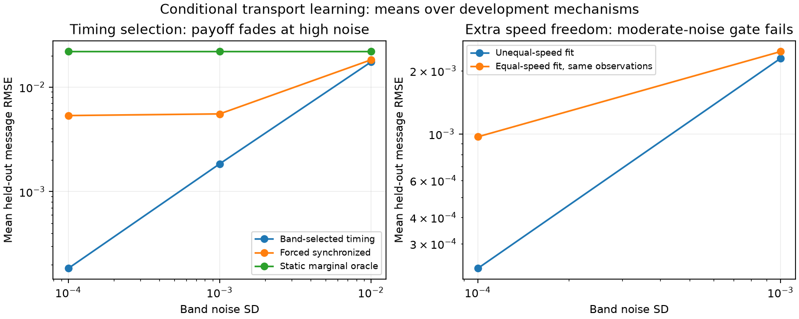

# Timing mechanisms: an exact ambiguity and the measurement that resolves it

**Two timing mechanisms can match every distance-two and distance-three contact
under every known loading, yet disagree under a new intervention. Distance-four
contacts distinguish them.** Under asynchronous exponential timing, the same
three short bands also identify both directional step/removal rate ratios and
all free gates, up to the unavoidable common time scale. These are conditional
mechanism-learning results, not a new general-purpose sequence architecture.

The [equal-speed protocol](ASYNCHRONOUS_PROTOCOL.md) was committed at `0c2d447`
before outcomes. The [unequal-speed extension](ASYMMETRIC_CLOCK_PROTOCOL.md) was
committed separately at `4a910b9` after that first screen passed. The second
extension fails its moderate-noise predictive-payoff criterion; its exact
identification result and that failure are both retained.

## Model, readout and prior art

A source loads at a known bond with weight q. Its arms step as independent
Poisson processes of rates rL and rR; shared removal is exponential with rate mu.
Each site has a time-independent independent pass probability. Failed passage
prevents that arm from reaching farther sites. Motors do not interact; there
are no retries or changing barriers. The observable is cross-arm **reach** before
removal, summed over sources. It is neither final-anchor occupancy nor a physical
polymer contact probability, so ordinary Hi-C data cannot be inserted directly.

Let H(a,b) be the probability both arms reach a,b steps before removal. First-step
conditioning gives

    H(a,0) = (rL/(rL+mu))^a
    H(0,b) = (rR/(rR+mu))^b
    H(a,b) = [rL H(a-1,b) + rR H(a,b-1)] / (rL+rR+mu).

For source k and endpoints i<=k<j, multiply H(k-i,j-k-1) by q_k and the left/right
path gate products, then sum over k. This exact calculation is quadratic for
H plus cubic contact assembly in the simple reference implementation; no
fixed-state linear scan or training-speed advantage is claimed.

Stochastic independent arm motion and exponential dissociation are established
physics, including in [conserved-current loop extrusion](https://doi.org/10.1186/s13059-024-03432-2).
That work also explains why common rate scaling cannot be inferred from contact
observations. [MoDLE](https://pmc.ncbi.nlm.nih.gov/articles/PMC9710047/) provides an
established external stochastic simulator. Neither published simulator was run
here. The investigated distinction is the local-band ambiguity, recovery and
falsification under controlled source access. A targeted literature search did
not establish priority for these specific identities; no priority claim is made.

The broader model-architecture alternatives were checked against
[selective-memory RLS](https://arxiv.org/abs/2211.07909),
[DeltaProduct](https://arxiv.org/abs/2502.10297), and
[stick-breaking attention](https://arxiv.org/abs/2410.17980). Selective rewriting,
multiple projected updates or query-dependent hazards alone do not provide a
sufficient novelty argument. The stopped [moment screen](MOMENT_MEMORY_RESULTS.md)
remains separate. This follow-up prioritizes a demonstrated mechanism-learning
question; it does not repair general associative recall.

## Exact ambiguity of the two shorter bands

First consider equal arm rates normalized to one, and set s=1/(1+mu). Marginal
reach is s^a, so distance-two observations under the two alternating loadings
identify effective gates a_i=s*l_i and b_i=s*r_i, using the earlier invertible
local design. At distance three, subtract the independent-marginal contribution.
The remaining middle-source term has coefficient

    theta = H(1,1)/s^2 - 1 = (1-s)/(1+s).

A synchronized shared geometric clock with survival s_sync=(1+s)/2 and raw gates
l_sync=(s/s_sync)*l, r_sync=(s/s_sync)*r has exactly the same effective gates and
coefficient theta. These transformed gates remain in [0,1]. Thus every loading
q gives the same contacts at distances two and three. No amount of additional
source patterns using only these bands can distinguish the two families.
This is structural nonidentifiability, not an optimizer failure.

At distance four, the pure left/right source terms are already fixed by the
effective gates. Mixed (one-step,two-step) paths have normalized coefficient

    rho_sync = 1/s_sync = 2/(1+s)
    rho_async = H(1,2)/s^3 = (s+3)/(s+1)^2.

Their difference is (1-s)/(1+s)^2>0 for 0<s<1. With positive gates and a positive
middle loading, the asynchronous distance-four contact is strictly larger.
The limiting no-removal case s=1 is genuinely indistinguishable. This proof
specifies both an impossible observation design and a sufficient extra one.

## Unequal speeds: recovery theorem and conditioning

Let u=rL/mu, v=rR/mu, sL=u/(u+1), sR=v/(v+1), and

    theta = 1/(u+v+1)
    rho12 = H(1,2)/(sL*sR^2) = 1+theta+(v+1)*theta^2
    rho21 = H(2,1)/(sL^2*sR) = 1+theta+(u+1)*theta^2.

The first-step recurrence proves these identities by substitution. Distance-two
bands identify a=sL*l and b=sR*r. At distance three,

    C_i,i+3 = q_i b_i b_(i+1)
            + q_(i+1) a_i b_(i+1) (1+theta)
            + q_(i+2) a_i a_(i+1).

Positive middle weight identifies theta. Subtract the pure-source terms at
distance four. The remainder is

    q_(i+1) a_i b_(i+1) b_(i+2) rho12
    + q_(i+2) a_i a_(i+1) b_(i+2) rho21.

Two complementary alternating loadings give an invertible two-column design
when gates are positive and source contrast is nonzero. Recover rho12/rho21,
then

    u = (rho21-1-theta)/theta^2 - 1
    v = (rho12-1-theta)/theta^2 - 1
    l = a/sL, r = b/sR.

This proves uniqueness of both ratios and gates under the stated observation
model. Absolute rL,rR,mu remain invariant under common scaling and therefore
unidentified. The asynchronous invariant rho12+rho21=2+3*theta+theta^2 differs
from the synchronized sum 2+2*theta for every theta>0, even at unequal speeds.

The inverse divides by theta^2: weak removal creates severe rate-conditioning
risk. Exact identifiability is not stable estimation. No noisy interval theorem
is asserted. The implementation pools local equations and refines point fits by
constrained least squares on the same distance-three/four observations. The
equal-speed comparator also fits those same observations, with the same effective
gate recovery and physical constraints; it is not denied the extra band.

## Development experiments

Two sizes 16/64, three gate seeds, three survivals, two timing families and four
noise levels give **144 rows**. Fit each family from bands two/three, select by
distance-four squared residual, and test uniform loading plus directional cuts
without consulting their outputs. Selection-band outcomes are calibration, not
held-out evidence. There are 84/372 observed scalars, including 26/122 extra
selection scalars. The static oracle is given exact effective marginal gates.

Mean held-out message RMSE on asynchronous mechanisms:

| Band noise SD | Correct family selections, both families | Selected model | Forced synchronized | Static oracle |
|---|---:|---:|---:|---:|
| 0 | 36/36 | below 1e-14 | .005349 | .021842 |
| .0001 | 36/36 | .000184 | .005338 | .021842 |
| .001 | 36/36 | .001843 | .005535 | .021842 |
| .01 | 22/36 | .017376 | .018212 | .021842 |

The first continuation criterion passes at SD .001: selection is 100% in this
small screen and mean error is threefold smaller. At SD .01 selection deteriorates
and much of the payoff disappears. These counts are not a powered calibration
or population-wide guarantee. All rows: [timing study](../results/asynchronous_transport_study.json).

An independent integral calculation integrates exponential removal against the
two gamma-arrival CDFs and agrees with the recurrence to 1e-11 in the unit tests.
A separate sampler draws removal lifetimes, Poisson event counts and independent
barrier failures; it never calls H. At 200,000 samples per source, its three
maximum map errors are .002457/.001331/.001288, all below a simultaneous Hoeffding
radius .006962. This validates the conditional reach calculation using a second
algorithm, not transfer to measured biology or a third-party simulator.



## Unequal-speed follow-up: exact recovery, modest moderate-noise benefit

The separate follow-up uses sizes 16/64/128, three fresh gate seeds, three right
speeds, three removal rates and three noise levels: **243 rows**. Both point fits
use identical observations; neither sees held-out messages. Noiseless maximum
gate error is below 8e-15 and maximum mean relative rate-ratio error below 5e-14.
This verifies the algebra numerically, without replacing its proof.

On the 54 unequal-speed cases at each noise level:

| Noise SD | Unequal-speed fit RMSE | Equal-speed fit RMSE | Mean relative rate-ratio error |
|---|---:|---:|---:|
| 0 | below 1e-14 | .000942 | below 5e-14 |
| .0001 | .000229 | .000969 | .69% |
| .001 | .002290 | .002467 | 6.70% |

The SD .001 gain is only about 7%, **failing the frozen twofold-improvement rule**.
One of those 54 fits reaches a physical boundary; all converge numerically.
At lower noise the benefit is larger. Retain the identification theorem but do
not select the extra rate flexibility as a general predictive improvement.
[All follow-up rows](../results/asymmetric_clock_study.json).

## Decision

Continue **controlled mechanism learning with explicit falsification and cost**.
The promising result is a constructive measurement design that resolves a real
ambiguity, with a moderate-noise predictive payoff for timing-family selection.
The unequal-speed fit requires better noise information before its additional
complexity is warranted. Next develop joint uncertainty over feasible timing
families and test rejection under non-exponential removal, changing gates and
interacting motors. Then map the reach observable to an external simulator's
actual output and obtain independently known intervention/loading information
before attempting measured-data claims. These remain open scientific gates.

```bash
python -m unittest discover -s tests -v
python study_asynchronous_transport.py
python study_asymmetric_clock.py
```
