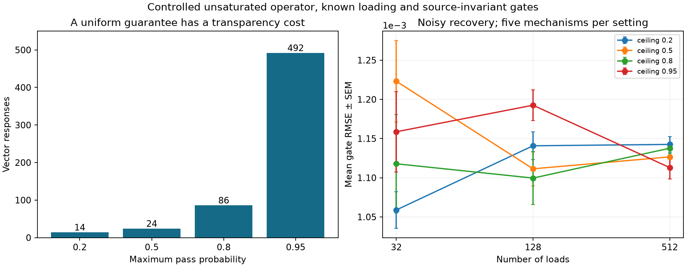

# Globally recover directional transport with a length-independent probe budget

**For any fixed gate ceiling rho<1, a finite number of controlled vector responses
globally identifies the two-arm transport mechanism at every sequence length.**
A projected recovery iteration converges globally and supplies a computable noise
bound. The response count depends on transparency rho; it is not always four.
This extends the [four-response strong-barrier result](DETERMINISTIC_PROBES.md).

The result assumes known input loading, an unsaturated operator, and gates that
stay fixed across source probes. It is a mechanism-recovery theorem, not evidence
of general task learning or biological manipulability of those source patterns.

## Spaced observations

Use the two alternating known loads `q_i^±=q0[1±delta(-1)^i]` and K value vectors,
one for each physical-position residue class modulo K:

`v_j^(c)=1{j mod K=c}`.

There are 2K vector responses. With m loads and m+1 physical positions, all responses
contain 2K(m+1) scalars; the recovery step selects 2(m-1) of them. The total squared
value-input energy over both source settings is 2(m+1), since the vectors partition
positions. These resources differ from the earlier four dense sign-vector probes.

For the gate pair at i, inspect output position i in the response with color
`(i+2) mod K`. Its desired contribution is the distance-two contact

`D_(i,i+2)(q)=q_i r_i+q_(i+1) l_i`.

Other contributions come only from physical positions `i+2+tK`, t nonzero. For K>=5
their distances are K-2, K+2, 2K-2, 2K+2, ... . On a finite chain some terms are
absent. If K=m+1 every position has a unique color and there are no aliases.

Let S extract the selected responses and apply the known two-by-two local loading
inverse. Then the observed preconditioned map has the form

`b(g)=g+T(g)`.

T is the contribution of the longer paths. Each local inverse has induced
infinity norm `1/(2q0 delta)`.

## A global contraction bound

On the convex box B=[0,rho]^(2(m-1)), define

```
lambda_K = (1+delta)/(2delta) * sum_(t>=1) [
    (tK-2)(tK-3) rho^(tK-4)
  + (tK+2)(tK+1) rho^(tK)
].
```

At rho=0 the sum is zero. At unique coloring K=m+1 the finite-chain alias bound
is exactly zero, regardless of the infinite-chain expression.

**Proposition.** `||T(g)-T(h)||_infinity <= lambda_K ||g-h||_infinity` on B.

**Proof.** A separation-d contact contains d source terms of degree d-1 in the
gates. The sum of absolute partial derivatives is at most
`q_max d(d-1) rho^(d-2)`, with q_max=q0(1+delta). Only the alias distances above
appear in a selected color output. Sum their derivative bounds and multiply by
the local inverse's norm. This gives lambda_K uniformly on B. Integrating the
Jacobian along the segment between two gate vectors proves the Lipschitz bound.

The sum is finite for every rho<1, and tends to zero as K grows. Thus a K with
lambda_K<1 always exists independently of chain length. It can be evaluated
without truncating a series: for r=rho^K, define

```
S0 = r/(1-r)
S1 = r/(1-r)^2
S2 = r(1+r)/(1-r)^3.
sum = K^2 S2 + 3K S1 + 2S0
    + rho^(-4) [K^2 S2 - 5K S1 + 6S0].
```

This is an ordinary geometric-series identity. The software handles rho=0
separately. The upper bound is sufficient, not the smallest possible probe count.

## Recovery and uniqueness

Let P_B be coordinatewise clipping to the gate box. Given preconditioned data b,
iterate

`g_(t+1)=P_B[b-T(g_t)]`.

P_B is nonexpansive in the infinity norm. If lambda_K<1 the iteration is a
contraction of the complete box into itself. Banach's theorem gives a unique
fixed point and convergence from every initial gate vector in B. With noiseless
data, the true mechanism is that fixed point. Therefore the controlled responses
globally identify it. This is stronger than local Jacobian full rank.

Implementation uses the equivalent preconditioned residual step

`g_(t+1)=P_B[g_t+S(y-F(g_t))]`.

The response F is evaluated using linear recurrences in O(mK) time and memory
per iteration, with no dense contact map or parameter Jacobian. K is constant in
m for fixed rho, but grows steeply as rho approaches one. The implementation
uses unique colors on short chains when that is cheaper. This can amount to
full column probing; it must not be described as a small fixed-response experiment.

## Noise and a posteriori guarantees

Suppose the selected scalar response errors are bounded in magnitude by eta.
The preconditioned error is at most eta/(2q0 delta). The noisy map is still a
contraction. For any candidate g in B, let r(g) be its infinity-norm fixed-point
residual under the observed data. Then

`||g-g_true||_infinity <= [r(g)+eta/(2q0 delta)]/(1-lambda_K)`.

This bound does not depend on a nonlinear least-squares optimum. For independent
Gaussian errors of SD sigma, a union bound for the N=2(m-1) selected response
coordinates gives `eta=sigma sqrt(2 log(2N/alpha))` with probability at least
1-alpha. Thus simultaneous maximum-coordinate error under Gaussian noise has
a sqrt(log m) term; it is not uniformly constant in length. The inverse's
bounded-noise Lipschitz constant and response budget are length-independent.
Numerical evaluations here are not outward-rounded arithmetic certificates.

## Fixed study and actual resource costs

[Protocol](COLORED_RECOVERY_PROTOCOL.md), [implementation](../colored_recovery.py),
[study](../study_colored_recovery.py), [all results](../results/colored_recovery_study.json).

Choose the first K giving lambda_K<=.5, or use unique colors if the chain is
shorter. The infinite-chain choices are:

| Gate ceiling | Colors | Vector responses | Proved contraction |
|---|---:|---:|---:|
| .2 | 7 | 14 | .1811 |
| .5 | 12 | 24 | .4460 |
| .8 | 43 | 86 | .4583 |
| .95 | 246 | 492 | .4994 |

This transparency cost matters. At m=32, ceilings .8/.95 use 66 responses with
unique colors; at m=128, ceiling .95 uses 258. The .95 guarantee is mathematically
uniform but expensive. Gates exactly one, noisy loads, unknown gate ceilings,
source-dependent controls and saturation are outside this theorem.

The study uses five mechanisms per combination of m=32/128/512 and those four
ceilings, each with noiseless and sigma=.001 responses: 60 mechanisms, 120 fits.
All iterations converged within 100 steps; all recorded Gaussian error bounds
and actual-noise bounds contained the gate error. Noiseless maximum error was
below 8.1e-13 in this random screen. At m=512, noisy gate RMSE was
.00114/.00113/.00114/.00111 for the four ceilings. Held-out loading plus a right
gate cut gave message RMSE .00117/.00139/.00184/.00230 respectively.

A separate near-transparent stress uses every gate=.999*rho, much harder than
independent uniform gates. At m=512 it took 12 iterations for rho=.8 and nine
for rho=.95 in the noiseless case, with maximum error below 1.4e-11. The noisy
versions converged in 11/eight steps, with maximum error .00294/.00410. All
eight stress fits converged; the fast two-step random fits were not treated as
evidence of worst-case convergence speed.



## Identifying a fixed mechanism does not establish source invariance

Consider the alternative control rule

`g(q)=clip(g_base + gamma * mean_i[1-((q_i-.5)/.4)^2], 0, rho)`.

For both calibration patterns, every load is .1 or .9 and the added term is zero.
For a uniform-.5 held-out source it equals gamma. Therefore the invariant mechanism
and this source-dependent mechanism produce exactly the same calibration data,
but different held-out responses. A finite calibration set cannot rule out all
unrestricted alternatives that agree on it. The recovery theorem explicitly
assumes a common mechanism; it cannot prove that assumption from its own probes.

[The mismatch screen](../study_probe_mismatch.py) uses ten mechanisms at each
ceiling .2/.5/.8, length 128, sigma=.001. A 97.5% calibration gate-error box yields
sharp positive-message bounds by evaluating the operator at its two gate-box
corners. Adding a 97.5% held-out noise bound gives at least 95% non-rejection
under the invariant null. This is a deliberately constructed failure case,
not an estimate of biological misspecification prevalence.

There were zero rejections in 30 invariant tests. Shifts .02 and .05 were
detected in all 30 tests each; shift .005 was detected in none. The detection
limit and the exactly matching calibration data are retained in
[the complete results](../results/probe_mismatch_study.json). An unseen-source
response can falsify invariance in these examples; passing it does not establish
invariance for every other source rule.

## Research decision and prior work

The direction now has a global inverse theorem, a matrix-free recovery algorithm,
and an explicit limit on what its observations can establish. Next investigate
local barrier-window conditions that permit transparent stretches with fewer
responses, then test externally observed mechanism transfer beyond this simulator.
The original predictive task benchmarks have not been improved by these results.

Color probing of decaying matrices and its error analysis already exist; see
[Frommer, Schimmel and Schweitzer](https://doi.org/10.1137/20M1364461),
[Tang and Saad](https://www-users.cse.umn.edu/~saad/PDF/umsi-2010-42.pdf), and
[structured matrix recovery](https://arxiv.org/abs/2212.09841).
The projected contraction uses standard fixed-point theory. The specialized
candidate contribution is recovering the hidden directional factorization across
controlled loading patterns with a global error guarantee. The coloring itself
is not claimed as original, and priority for this combined result is unestablished.

Reproduce: `python study_colored_recovery.py`, `python study_probe_mismatch.py`,
`python plot_colored_recovery.py`, `python -m unittest discover -s tests -v`.
