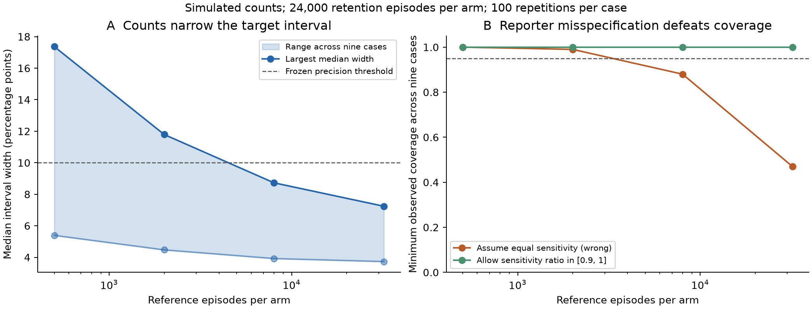

# Counted loading-reference results

2026-11-01. Protocol ccca9f1; implementation c60c031. All reference measurements
below are simulated. The study replaces a supplied narrow loading-ratio interval
with counts whose sampling error is propagated; it does not validate a reporter
or biological perturbation.

The target is observed absence after the controlled-loss intervention; failed
loading and optical loss contribute to it. It is not a uniquely attributed
biological removal probability.



At 32,000 reference episodes per arm, all nine mechanism/ratio cells cover the
true target in 100/100 repetitions (Wilson lower bound .963) and have median
95%-confidence interval widths between **3.73 and 7.24 percentage points**.
Both frozen primary gates pass. The true joint model has at least 95% coverage
by construction; observing 100% coverage in a small screen does not prove exact
nominal coverage or optimal interval length.

| Reference episodes per arm | Median-width range over nine cells | Minimum coverage |
|---:|---:|---:|
| 500 | 5.39–17.37 pp | 100/100 |
| 2,000 | 4.47–11.79 pp | 100/100 |
| 8,000 | 3.92–8.73 pp | 100/100 |
| 32,000 (primary) | 3.73–7.24 pp | 100/100 |

There are also 24,000 initiated retention episodes **per arm**. The reference
cohorts add 2m episodes; these are not a free calibration or a measured scanner
cost. This experiment has more total information than the earlier 24,000-total
episode survival comparison and cannot establish a sample-efficiency advantage.
The smaller-budget results are descriptive and do not establish an optimal
budget or independent confirmation of a post-outcome recommendation.

## Defeating the reference

When calibration-arm reporter sensitivity is 10% lower but equal sensitivity
is incorrectly assumed, largest-budget coverage falls to **47/100** in the
worst cell. Larger reference cohorts make the wrong assumption more precise.
Allowing the correct sensitivity-ratio contract [.9,1] restores 100/100 coverage
in all nine largest-budget cells, with median widths 6.13–11.56 pp. The coverage
gate passes; the wider intervals are part of the result, not a nuisance to hide.
Some intermediate budgets are narrower/wider through sampling; no monotonic
empirical-width guarantee is claimed.

The [exact four-observable counterexample](COUNTED_LOADING_THEORY.md) proves
that uncontrolled reference sensitivity can preserve all observed probabilities
while changing the target by 9/286. A second reporter alone does not settle the
scientific question.

## Verification and scope

`verify_counted_loading.py` independently regenerates 7,200 reference datasets,
reconstructs 10,800 interval images using an independent exact-binomial API,
checks 21,600 primal/dual certificates without an optimizer, and reconstructs
physical endpoint mechanisms. The regression suite additionally checks the
counterexample with rational arithmetic.

Reproduce:

```sh
python study_counted_loading.py
python verify_counted_loading.py
python -m unittest discover -s tests -p test_counted_loading.py -v
```

Sources and comparison limits are in [the theory note](COUNTED_LOADING_THEORY.md).
The reciprocal identity has the classical Stern–Volmer functional form; LP
uncertainty propagation and measurement-error partial identification are prior
methods. Any originality claim must concern the narrow experiment/target result
and survive independent review. No measured cohort currently meets its loading-
reference contract. See [the review packet](INDEPENDENT_REVIEW_PACKET.md).
