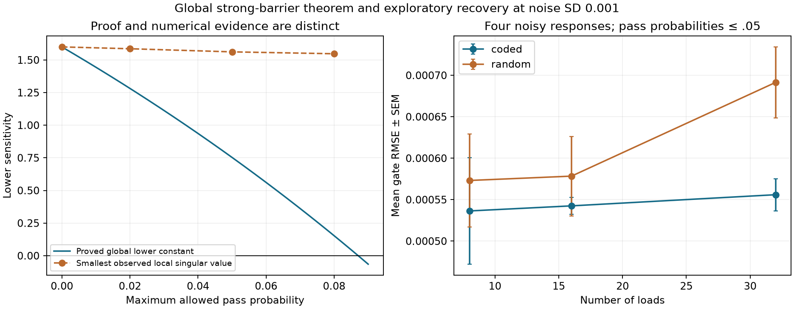

# Four responses give global stable recovery in a strong-barrier regime

**Four deterministic vector responses globally identify every gate of the
unsaturated two-arm operator when all pass probabilities are sufficiently small.**
The inverse has a length-independent Lipschitz bound. This strengthens the earlier
finite Jacobian-rank screen to a global result on a stated convex parameter box.
The sufficient condition is restrictive: at loading center .5 and contrast .8,
the proof requires every gate below approximately .08707. Most earlier experiments
used substantially larger pass probabilities and do not inherit this guarantee.

[Protocol](DETERMINISTIC_PROBES_PROTOCOL.md), [bound implementation](../deterministic_probes.py),
[study](../study_deterministic_probes.py), [complete results](../results/deterministic_probe_study.json).

## Observation design

There are m known loads and m-1 left/right gate pairs, giving p=2(m-1) parameters
and m+1 physical positions. The symmetric zero-diagonal raw contact operator is
D(q;g). Gates remain fixed while the external source pattern changes. Use

```
q_i^+ = q0 [1 + delta (-1)^i]
q_i^- = q0 [1 - delta (-1)^i]
v_i^(0) = 1
v_i^(1) = (-1)^floor(i/4)     # repeated ++++---- at physical positions
```

Let F(g) concatenate the four responses D(q^±;g)v^(a). There are 4(m+1) scalar
observations. Value-probe energy and loading are matched to the two-Rademacher
probe control. Production scans produce the same responses without constructing
a dense matrix; this study uses a dense sensitivity reference for verification.

## Theorem

Assume known q0>0, 0<delta<1, and g in the convex box [0,rho]^p with 0<=rho<1.
Define

```
q_max = q0 (1+delta)
tau(rho) = 4 sqrt(2) q_max [(1-rho)^(-3) - 1]
c = 4 q0 delta - tau(rho)
C = 4 q0 + tau(rho).
```

For all g,h in that box,

`c ||g-h||_2 <= ||F(g)-F(h)||_2 <= C ||g-h||_2`.

If c>0, F is globally injective on the whole box and its inverse is Lipschitz.
The constants do not depend on m. A positive sufficient constant is obtained when

`rho < 1 - [1 + delta/(sqrt(2)(1+delta))]^(-1/3)`.

This is a sufficient condition, not a necessary boundary for recoverability.

### Proof: exact local frame at zero gates

At g=0, every gate derivative changes only a distance-two contact. Write that
contact perturbation as

`w_i = q_i delta_r_i + q_(i+1) delta_l_i`.

For one load pattern, the constant-value response derivative at position i is
`w_(i-2)+w_i`, taking missing boundary terms as zero. The other response is
`v_(i-2) w_(i-2)+v_(i+2) w_i`. The repeated code satisfies
`v_(i-2)=-v_(i+2)` whenever both terms exist. Squaring and summing the two
responses over positions cancels every cross term and yields `4 sum_i w_i^2`.
The same identity holds at boundaries because each individual edge has two
endpoints and both probe entries have magnitude one.

For each gate pair, the two loading patterns map its perturbation to the two
w_i values through a two-by-two matrix with singular values 2q0 and 2q0 delta.
Consequently J0=DF(0) has exactly m-1 singular values 4q0 and m-1 singular values
4q0 delta. This is a local frame identity, independent of length.

### Proof: bound all longer transport paths

A contact at physical separation d contains d source terms, each a product of
d-1 gate factors. Its summed absolute gate derivatives are at most
`q_max d(d-1) rho^(d-2)`. Distance-one derivatives vanish; distance-two
derivatives equal J0 at every gate vector. Thus the tail J(g)-J0 contains only
separations d>=3.

For a fixed output row, at most two contacts have each separation d. Therefore

`||J(g)-J0||_infinity <= 4 q_max [(1-rho)^(-3)-1]`.

For a fixed directional gate and separation d, summing the number of source
terms across intervals containing it gives d(d-1)/2. Each symmetric contact
contributes to two output rows. There are four response blocks, so

`||J(g)-J0||_1 <= 8 q_max [(1-rho)^(-3)-1]`.

Here the induced infinity norm is the maximum absolute row sum, and the induced
one norm is the maximum absolute column sum. The geometric identity used in both
bounds is `sum_(d>=3) d(d-1) rho^(d-2)=2[(1-rho)^(-3)-1]`.
The spectral norm is bounded by the square root of the product of those two
norms, giving tau(rho).

Finally, integrate J along the line segment joining g and h, which stays inside
the box. Its difference from the fixed linear map J0 has norm at most
tau(rho)||g-h||. The triangle and reverse-triangle inequalities, together with
J0's singular values, give both global secant bounds. Local nonsingularity alone
would not justify this step; the common J0 and uniform tail bound do.

## A recovery bound that does not require a globally optimal optimizer

Suppose observed y=F(g*)+e with ||e||<=eta and g* in the proved box. For ANY
candidate g_hat in the same box, the theorem gives

`||g_hat-g*|| <= [||F(g_hat)-y|| + eta]/c`.

The residual is observable. The argument uses the triangle inequality and the
global secant bound; it does not assume that nonlinear least squares found its
global optimum. For independent N(0,sigma^2) output errors, choose
`eta=sigma sqrt(chi_square_(4(m+1), .95))` for a 95% noise-norm bound.
With a residual of order sigma sqrt(m), the resulting root-mean-square gate
bound remains of order sigma as length grows. This is not a length-independent
simultaneous maximum-coordinate error guarantee. Floating-point evaluations here
are ordinary numerical checks, not outward-rounded interval arithmetic.

## Experiments and limitations

At q0=.5, delta=.8 and rho=.05, the proved constants are c=.75308 and C=2.84692.
The local/global screen covers 240 mechanisms: ten at every combination of
m=8/16/32/64 and rho=0/.02/.05/.08/.2/.8. Coded and random probes are matched
within each mechanism. All checked coded tail and secant inequalities pass.
The smallest observed coded singular value is 1.562 at rho=.05 and 1.230 at
rho=.8. The latter is encouraging numerical evidence outside the theorem,
not an extension of the proved regime.

Free-gate fitting uses five mechanisms per size/noise setting at rho=.05, with
three starts, known domain constraints, and held-out loading plus a right-gate
cut. Mean gate RMSE:

| Loads | Coded, sigma=.001 | Random, sigma=.001 | Coded, sigma=.01 | Random, sigma=.01 |
|---|---:|---:|---:|---:|
| 8 | .000536 | .000573 | .005172 | .005603 |
| 16 | .000543 | .000578 | .005003 | .006065 |
| 32 | .000556 | .000691 | .005095 | .006240 |

All 60 selected fits report convergence. The largest multistart objective
spread is 7.45e-12. All 30 coded recovery radii contain the true gate vector;
the deterministic bound using the actual noise norm also holds in every case.
The confidence radius is conservative: at sigma=.001 its RMS equivalent is
.00430/.00371/.00361 for lengths 8/16/32, compared with actual RMSE near .00054.
Held-out cut-message RMSE is about .00043–.00052 at sigma=.001 and
.00478–.00567 at sigma=.01. This remains a matched, synthetic transport system.



## Research decision

Continue the constant-response recovery direction: there is now a specific
global theorem and an estimator-independent error bound. Next try to replace
the uniformly small-gate assumption with a condition on products over barrier
windows, or find an obstruction. Then introduce noisy loads, source-dependent
gates and extra transport paths; a claimed confidence bound must either include
those disturbances or detect that its model assumptions are violated.

The existing shared-controller transfer result and this free-gate recovery result
answer different questions. Neither establishes a general task-learning benefit.
The original learned gates often include highly transparent directions; they
cannot be declared certified by the strong-barrier theorem.

Structured probing and sparse-matrix coloring are established ideas. Relevant
precedents include [structured matrix recovery](https://arxiv.org/abs/2212.09841)
and [matrix probing and conditioning](https://doi.org/10.1137/110825972).
The specialized result here concerns hidden directional mechanisms across
controlled loading conditions and a uniform inverse bound for this operator.
Priority beyond those precedents remains unestablished.

Reproduce: `python study_deterministic_probes.py`,
`python plot_deterministic_probes.py`, `python -m unittest discover -s tests -v`.
