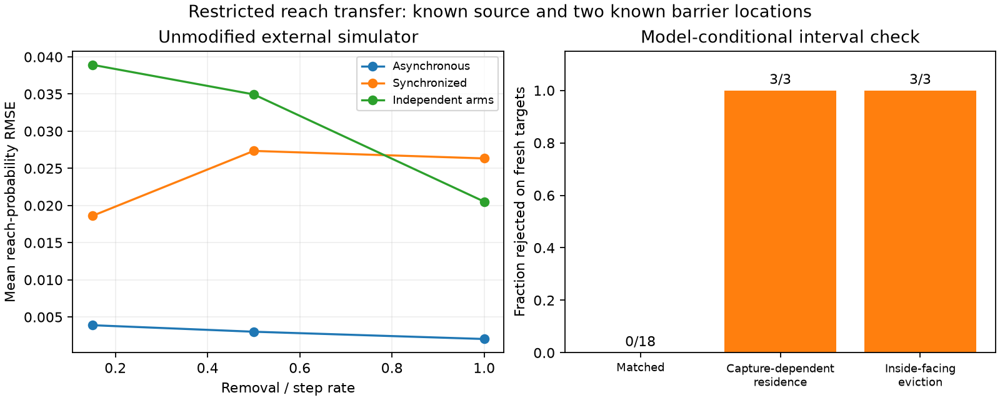

# Independent event-engine validation and mechanism rejection

**The restricted asynchronous reach model transfers to an unmodified external
simulation engine, and rejects both tested departures from its assumptions.**
All 18 matched cases pass the validation check; all six mismatch cases reject
on fresh outcomes. Mean reach-probability RMSE is .002985, versus .031473 for
independent arms and .024099 for synchronized timing with identical fitted
marginal parameters. This is a restricted simulator result, not experimental
chromatin prediction, a general biological architecture, or superiority to dLEM.

The [protocol](EXTERNAL_ENGINE_PROTOCOL.md) was committed at `e71840a` before
case outcomes. All 24 cases and all target profiles are retained in
[the result JSON](../results/external_engine_study.json).

## Engine and exact observable bridge

The independent backend is [lefsim](https://github.com/abdenlab/lefsim), by Nezar
Abdennur, MIT licensed. Version 0.1.0 is a newly released alpha simulator.
[PyPI provenance](https://pypi.org/project/lefsim/0.1.0/) identifies publisher
commit `db4f5dadd28d16d0c76911202ff9d1b6205bd70e`. Its public model documentation
and event API were inspected; its engine was used without modifications. The
macOS arm64 wheel SHA256 is
`afc3013a418fd6da62f3016a52fedf5039f82f33b39d96ca1635eefe9e3cc47c`.
The study records package versions and source revision. This implementation is
independent of this repository; it is not yet an established benchmark. The
[provenance record](../results/external_engine_provenance.json) verifies the
installed extension against the downloaded, hash-checked wheel.

Each episode starts one motor with coincident legs at site 8 on a 17-site lattice.
It ends just before the first Respawn or Evict event. The post-respawn site is
excluded. Let A=8-left_terminal and B=right_terminal-8. Their empirical joint
tail P(A>=a,B>=b) is a reach observable, not a polymer contact probability or the
probability of occupying a particular anchor pair. Because motion is outward,
the terminal tail is precisely the event of reaching both thresholds before
removal. The coincident origin differs from the earlier bond-origin readout;
the adapter uses the appropriate step distances instead of feeding anchor maps
directly into the old contact routine.

The matched model has independent unit-rate step clocks and constant shared
removal rate mu, including when blocked or captured. Convergent CTCFs at sites
5/11 capture the outward-facing arm with probabilities pL,pR. From this source,
no backside eviction is encountered. Capture stops that arm but permits the
other to continue. In the reach calculation, capture at a site affects the
probability of reaching **beyond** it: it is a gate on leaving that site, not on
arriving there. With the [continuous-time kernel](ASYNCHRONOUS_RESULTS.md) H,

    R(a,b) = H(a,b) * gL^(1[a>=4]) * gR^(1[b>=4]),
    gL=1-pL, gR=1-pR, 0<=a,b<=8.

This factorization requires source-independent static capture and constant
removal. It does not cover motor traffic, eviction, capture-dependent residence,
retries or fluctuating barriers. Gate positions, nonbarrier gates and the step
rate are supplied. No free-gate recovery theorem is being empirically confirmed
by this restricted three-parameter calibration.

## Calibration, uncertainty and rejection

From 10,000 independent calibration episodes, use only three proportions:
P(A>=1), P(A>=4), P(B>=4). The first gives s=1/(1+mu) with known unit step rate.
The remaining probabilities are s^4*gL and s^4*gR. Point gate estimates are
clipped to [0,1]. The inferred physical quantity is a removal/step rate ratio;
this is not an experimentally calibrated absolute time scale.

For each probability, a two-sided Clopper-Pearson interval with error alpha/3
and alpha=.025 gives simultaneous enclosure by a union bound. Dependence between
the three events within an episode does not invalidate this bound; trials across
episodes are independent under the sampling model. Convert the probability
intervals to parameter boxes using

    s in [slo,shi]
    gL in [max(0,pLreach_low/shi^4), min(1,pLreach_high/slo^4)],

and similarly for gR. A zero lower survival gives the conservative upper gate
one. Empty intersections reject the assumptions. Correlations are discarded,
so these boxes can be conservative.

Reach is monotone in survival and pass probabilities. Evaluating the parameter
box corners therefore encloses all 81 joint probabilities under the model,
including the prespecified interventions setting left or both captures to one.
Fresh test episodes have their own simultaneous Hoeffding radius
sqrt(log(2*81*3/.025)/(2*10000)), covering all three 81-event target profiles.
A target outside the model interval enlarged by this sampling radius rejects.
Under the matched assumptions, the probability of any false rejection in one
case is at most .025+.025=.05. This is a casewise guarantee conditional on the
model and sampling assumptions, not study-wide 95% coverage or biological truth.

## Frozen outcomes

Removal ratios .15/.5/1, capture pairs (.2,.8)/(.8,.2), and three seeds give 18
matched cases. Each has 10,000 calibration episodes and three independently
sampled 10,000-episode targets: no intervention, left capture one, and both one.
The two comparator kernels use exactly the same fitted survival and gates.
They are controlled factorization/timing ablations, not published competing
biological predictors or fitted dLEM models.

| Readout model | Mean RMSE across matched target profiles |
|---|---:|
| Asynchronous shared removal | .002985 |
| Synchronized shared removal | .024099 |
| Independent arms | .031473 |

No matched case rejects (0/18), and every fitted parameter box contains its
generating parameter triple in this check. The maximum point error in any
matched target event is .02252. Mean model-interval widths per profile range
from .0040 to .0462 probability units; successful enclosure does not imply every
query is precise. There is no superiority claim at matched wall-clock compute
or against other published models.

Two mismatch types use pL=pR=.8 and three removal ratios each:

| Mismatch | Rejected on new target profiles |
|---|---:|
| Captured removal slowed to mu/4 | 3/3 |
| Right CTCF reversed, enabling inside-facing eviction | 3/3 |

All calibrations remain nonempty; rejection uses fresh target outcomes rather
than merely failing to fit parameters. Capture-dependent residence changes the
other arm's opportunity to move, while eviction can remove the whole motor.
Neither is represented by the restricted factorization. The current predictor
fails on those processes, and the test detects these six failures. It does not
prove sensitivity to every possible misspecification.

Total simulation count is 960,000 episode executions, with package construction
and events handled by the external engine. Calibration and target seeds are
disjoint within each case. Some seed ranges are reused across different
mechanisms, so case outcomes are correlated through common random numbers;
the study does not supply independent case-level replications. Simulation time is not laboratory
cost, and episodes are not biological replicates. The continuation gate passes:
18/18 matched acceptance, 10.54-fold mean RMSE reduction over independent arms,
and 6/6 tested mismatch rejections.



## Consequence for the biological-model claim

Continue controlled mechanism identification and uncertainty-aware intervention
prediction. The next independent test must challenge realistic state-dependent
residence, traffic and observable definitions, with new protocols and stronger
published comparators. The [dLEM audit](BIOLOGICAL_NOVELTY_AUDIT.md) is a mandatory
boundary on architecture novelty: a trainable extrusion layer is already prior
art. No measured-data or foundational-learning claim follows from this transfer.

```bash
python -m pip install -r requirements.txt -r requirements-external.txt
python -m unittest discover -s tests -v
python study_external_engine.py
python plot_external_engine.py
```
