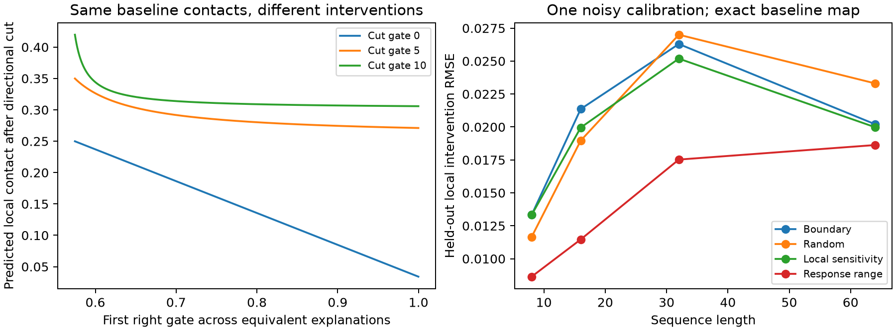

# Identifiable routing and intervention calibration

## Selection after three screens

The selected direction is **partial identification of mechanistic routing**:
learn what the contact observations determine, retain uncertainty about what they
do not, and choose interventions that remove consequential ambiguity. Extrusion
Net remains an independent project. This is a mathematical investigation of its
positive scan operator, not a claim of a new general learning paradigm.

The competing saturation route raises separated-block matrix rank from 2 to as
high as 12 in the screened 12-row blocks, but leaves parameter-Jacobian nullity
unchanged. An invertible entrywise nonlinearity cannot identify parameters that
already yield the same input matrix. Nonlinear kernels have substantial precedent.

The shared-controller route is an essential control: the sampled four-feature
logistic controller has full local Jacobian rank (8/8) even in one context. Thus
the free-position result below must **not** be advertised as proof that the
actual shared neural controller is globally nonidentifiable. Conversely a local
full-rank check does not prove global identifiability.

## Exact operator result

Write the upper-triangular reduced contact matrix as C[i,j] = D(i,j+1), with
m = sequence length minus one. Its diagonal q contains the positive loads. Let
L and R be strictly upper-bidiagonal matrices with first superdiagonals l and r.
Then the implemented two-arm sum gives

    C = (I-L)^(-1) diag(q) (I-R)^(-1).
    B = C^(-1) = (I-R) diag(1/q) (I-L).

B has only three nonzero upper bands:

    B[i,i]   = 1/q[i]
    B[i,i+1] = -s[i] = -l[i]/q[i] - r[i]/q[i+1]
    B[i,i+2] =  t[i] =  r[i] l[i+1]/q[i+1].

Consequently the observable matrix determines q, s and t, rather than each gate
separately. The first three bands of C suffice to recover those coefficients:

    s[i] = C[i,i+1] / (q[i] q[i+1])
    t[i] = q[i+1] s[i] s[i+1] - C[i,i+2]/(q[i] q[i+2]).

Choose an initial right gate u = r[0]. Every other gate is forced by

    l[0] = q[0] (s[0] - u/q[1])
    l[k] = t[k-1] q[k] / r[k-1]
    r[k] = q[k+1] (s[k] - l[k]/q[k]).

For strictly interior gates and positive loads, continuity leaves an open interval
of admissible u around the original value. The recurrence makes every solution
unique once u is specified. Therefore the noiseless free-gate contact map has an
exactly one-dimensional equivalence family (for m >= 2). No number of further
ordinary measurements of the same contact operator resolves that family.

This is a specialized factorization argument. Factorization nonuniqueness,
Riccati recurrences, system identification and partial identification are all
established subjects. Priority for this particular specialization is unproven.

## Feasible set and sharp directional bounds

The recurrence can be written r[k] = A[k] - B[k]/r[k-1], where
A[k] = q[k+1] s[k] and B[k] = q[k+1] t[k-1] > 0. All r[k] increase with u; all
l[k] decrease with u. The constraints 0 <= l,r <= 1 consequently define one
interval in u. `admissible_initial_interval` computes its closure in O(m) by
propagating allowable intervals backward through these monotone recurrences.
The implementation assumes interior source gates; zero-product degeneracies
require separate handling. Floating-point endpoints are numerical evaluations
of the exact algebra, not interval-arithmetic certificates.

Consider an explicitly defined computational intervention r[k] <- 0, holding all
loads and other gates unchanged. For a <= k < b,

    C_cut[a,b] = C[a,b] - C[a,k] product(r[k:b]).

All right gates increase with u, so every affected contact decreases with u.
The two feasible endpoint factorizations therefore give simultaneously sharp
entrywise counterfactual bounds. They also bound any nonnegative weighted sum
sharply. This does not establish sharp bounds for signed value-channel sums.
Known-scale Poisson saturation preserves the ordering.

Some counterfactuals are already identified without learning the gates. If both
directional passes at site k are multiplied by the same c[k], every path term
between physical endpoints i and j acquires the same product over interior
sites. Thus

    D_changed(i,j) = D(i,j) product(c[i+1:j]).

Common barrier modulation is invariant across the entire equivalence family;
direction-specific modulation generally is not. Global load scaling is likewise
identified. This distinction is more informative than simply labeling the whole
model identifiable or nonidentifiable.

## One calibration observation

Set r[0] to zero and measure C_cut[0,1]. Then

    r[0] = (C[0,1] - C_cut[0,1])/q[0].

The recurrence recovers the remaining gates. A single scalar intervention
observation is necessary to remove the one-dimensional regular ambiguity and is
sufficient under these exact assumptions. Actual biological perturbations need
not change only one directional pass; that correspondence is not established.

## Small experiments and noise

`screen_directions.py` independently matches the production log-sum operator to
the matrix factorization (maximum absolute error about 8e-16). Free gates have
Jacobian ranks 11/12, 27/28 and 59/60 at lengths 8, 16 and 32. Saturation preserves
each deficit. Exact single-observation recovery errors are below 2e-15.

`study_identification.py` evaluates 80 seeded heterogeneous mechanisms: twenty
each at lengths 8,16,32,64. Baseline-equivalent maps differ by at most 4.5e-16.
The analytic feasible interval matches the 4001-point grid to within its mesh
spacing. Both-arm barrier counterfactuals agree to about 2.3e-16. Independent
tests check the directional envelopes against intermediate factorizations.

One noisy intervention is chosen using only contact-derived coefficients. The
largest predicted response span is compared with boundary, middle, random and
midpoint-sensitivity choices. At noise standard deviation .01, mean RMSE on the
other single-contact intervention responses is:

| Length | Boundary | Middle | Random | Midpoint sensitivity | Response span |
|---|---:|---:|---:|---:|---:|
| 8 | .01332 | .01204 | .01165 | .01332 | .00864 |
| 16 | .02136 | .01732 | .01896 | .01995 | .01146 |
| 32 | .02630 | .02151 | .02700 | .02519 | .01753 |
| 64 | .02021 | .02503 | .02331 | .01998 | .01863 |

These are exploratory synthetic results. Baseline contacts are exact; only the
calibration scalar is noisy. The outcome measures one local contact for each
held-out intervention, not a downstream classification task or full biological
contact-map prediction. The response-span heuristic is not claimed optimal or
an invention of experimental design. Baseline observation noise and model
misspecification remain major limitations.

## Extension and limits

For a pure d-stage positive transport cascade of m positions, the inverse has
upper bandwidth d and unit diagonal. Its off-diagonal bands contain at most
dm-d(d+1)/2 coordinates, versus d(m-1) free gates. The Jacobian therefore has
nullity at least d(d-1)/2. Numerical screens at m=8,16 and d=1..4 attain this
bound: 0,1,3,6. This dimension count does not prove generic global recovery,
does not count whole experiments, and does not apply unchanged to a full network
with residual/channel mixing and nonlinear layers. Banded factorization is
classical; the dimension count alone is not a new learning principle.

## What could justify a substantially higher novelty claim

The promising target is an efficient, noise-robust theory and learning procedure
for *which routing counterfactuals are identifiable*, together with calibration
requirements for deeper shared controllers. This requires a result beyond the
current classical factorization specialization, comparison against existing
system-identification/experimental-design methods, and a useful task where the
distinction changes generalization. Passing the small screens does not earn 9/10.

Closest prior work includes [Hydra](https://arxiv.org/abs/2407.09941),
[dLEM](https://github.com/chikinalab/dLEM),
[factorization of difference operators](https://arxiv.org/abs/1709.07496),
[hybrid-model identifiability](https://doi.org/10.1038/s41540-024-00460-3), and
[optimal experiments for partial identification](https://arxiv.org/abs/2605.06993).

Reproduce with `python screen_directions.py`, `python study_identification.py`,
and `python -m unittest discover -s tests`. See results/direction_screen.json and
results/identification_study.json for all singular values, cases and noise levels.
Render the figure with `python plot_identification.py`; its left panel is a
separately seeded illustrative length-16 mechanism, and its right panel uses
the retained eighty-mechanism study.

## Noisy-map follow-up

The exact-map selection gains above do not generalize consistently when the
baseline map is also noisy. See [all three follow-up rounds](NOISY_IDENTIFICATION_RESULTS.md)
and the resulting [local calibration-budget bound](STABLE_CALIBRATION.md).
A fitted family is not a confidence region for a noisy contact map.
