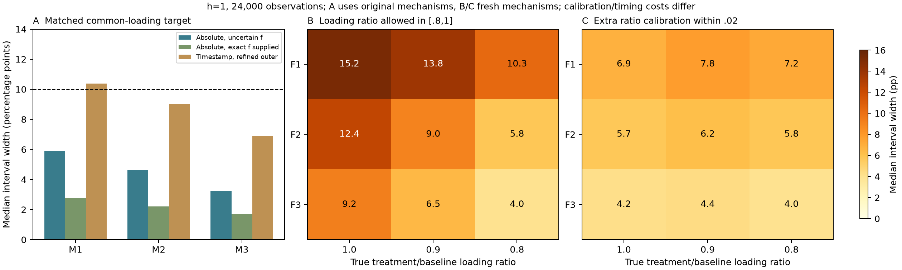

# Loading uncertainty: a useful target, a coverage failure and a calibration requirement

2026-11-01. The new [target-specific theory](LOADING_TARGET_THEORY.md) permits
sharp absence-probability bounds in the h=1 submodel despite unknown loading and
uncertain intervention strength. Matched simulations pass the declared pilot
gates. A loading-drift stress defeats the first contract, and the separately
frozen ratio-robust follow-up shows the value and cost of an extra calibration.
No biological measurement or new architecture is claimed.



## Common loading can cancel from the target

Protocol c2bc901 and estimator 22f8447 precede the finite screen. At gamma=.3,
target multiplier g=3 and calibration f in [1.8,2.2], unknown common loading
ell in [.6,1] cancels from a reciprocal-survival prediction. Nonidentified rates
can still give the same target at the calibration clock. Changing the clock can
break that invariance. The full-generator checks preserve all spatial states,
not merely their summed retention, in the specified gauge example.

At N=24000 initiated observations, medians below are interval widths in
percentage points. Every mechanism has 100 independent simulation replicates.

| Mechanism | Absolute snapshots, uncertain f | Same counts, exact f supplied | Timestamp outer interval | Refined timestamp outer interval |
|---|---:|---:|---:|---:|
| M1 | 5.91 | 2.76 | 14.27 | 10.38 |
| M2 | 4.64 | 2.20 | 11.96 | 9.01 |
| M3 | 3.26 | 1.72 | 9.24 | 6.88 |

The uncertain-f snapshot intervals cover the target in 100/100 per mechanism
(Wilson lower 96.30%). Exact-f coverage is 100%,100%,99%. Both snapshot methods
pass the frozen coverage/width gate. The initial timestamp outer interval fails
width; the separately frozen refinement reaches the same two-of-three width
criterion. Refined timestamp coverage is 100/100 in all three mechanisms. It
reuses development counts, preserves the initial failure and is not a new
confirmation. Numerical relaxation can still add up to 3.15 percentage points
one-sided slack in the worst recorded experiment, so neither timestamp interval
is claimed optimal. Expected duration per initiated observation is 3.333 model
time units for random clocks versus 5 for the timestamp schedule. Accurate f
also supplies extra information. Equal counts are not equal acquisition costs.

## Loading drift breaks the common-loading contract

With treatment loading .8*baseline, the first uncertain-f interval covers the
unchanged target in 0%,0%,73% across the three mechanisms at N=24000. Most of the
third mechanism's covered cases are conservative [0,1] fallbacks after numerical
model incompatibility. This is neither useful coverage nor robustness. The full
stress record remains available. The same-loading identity cannot be applied
silently when treatment changes the number of successfully initiated episodes.

Protocol 868f4da freezes a new four-variable identified set allowing loading
ratio kappa in [.8,1]. Three fresh mechanisms and kappa=1,.9,.8 yield nine cells,
100 replicates each, with all methods using the same new counts.

| Loading information | Coverage gate | Width gate | Median widths across nine cells |
|---|---|---|---:|
| Assume equal loading | Fail | Pass | Narrowness is not valid uncertainty |
| Allow kappa in [.8,1] | Pass | Fail | 4.03–15.23 pp |
| External kappa calibration within .02, clipped to [.8,1] | Pass | Pass | 4.03–7.76 pp |
| Exact kappa supplied | Pass | Pass | Full outputs retained |

The broad and calibrated ratio methods cover 100/100 targets in every cell.
The exact-data broad widths already exceed 10 percentage points in two cells:
more survival counts cannot shrink those structural spans below that tolerance.
The narrow reference changes the information contract. Its accuracy and cost
are assumed, not measured. The 10-point width threshold is a frozen computational
pilot criterion, not a biological/clinical meaningful-effect standard.

## Verification and paper meaning

All 131 local tests pass. Independent replay regenerates 1,800 saved experiments,
checks 6,600 interval outputs and **23,460 LP optimality certificates**, plus 18
full-generator survival comparisons. The replay uses separate confidence-interval
formulas and direct primal/dual checks without an optimizer. Endpoint mechanisms
verify attainability. Certificates are conditional numerical proofs for the
stated LPs, not biological truth or a guarantee outside the parameter class.

The first screen's initial run encountered a JSON serialization error, which was
fixed without changing its seed, estimator, parameter grid or criteria. An
additional metadata correction distinguishes empty exact-model sets from [0,1]
confidence fallbacks and gives each control its own exact-data width. Neither
correction changes interval predictions or the frozen gates.

```sh
python study_loading_target.py
python study_loading_drift.py
python study_timestamp_refinement.py
python verify_loading_research.py
python -m unittest discover -s tests -v
```

This supplies a stronger focused theory-paper argument: identify the prediction
that tolerates unknown loading, demonstrate the failure when loading drifts, and
quantify which reference information restores useful intervals. The projection,
binomial and LP tools are conventional. Novelty belongs, if established, to the
specific kinetic target/boundary and calibration result, not a new optimizer or
learning paradigm. h!=1, uncertain target loading, arbitrary optical loss and
measured transfer remain open; an explicit test shows failure for h!=1.

For this focused theory/measurement artifact, an overall assessment near
**7.5/10** is now reasonable (roughly one-point uncertainty): research quality
around 8, novelty around 6.5-7 and weaker biological validation. The rating is
not a submission-readiness certificate. Before submitting: independent proof and
priority feedback, a meaningful application tolerance, and validation appropriate
to the final headline. A biological prediction paper needs measured intervention/
loading controls and an untouched perturbation cohort; the theory note can keep
its narrower scope. Keep passive-memory exploration out of this manuscript.

Claim/figure skeleton: the observation/loading gauge; exact target identified
sets; coverage and width versus information; loading-drift failure and calibration
recovery; biological/reference confirmation only if obtained and justified.
