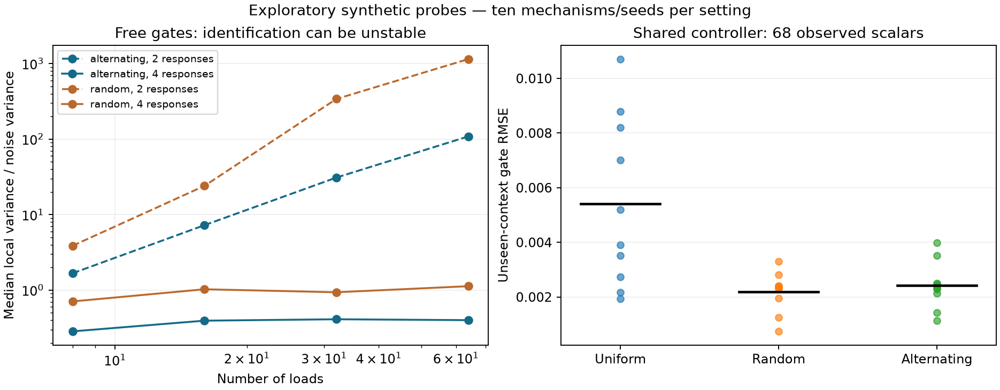

# Learn transport by probing it

**Two known loading patterns exactly identify every directional gate of the
fixed two-arm operator from adjacent contacts.** A single fixed loading pattern
cannot do this even if its entire contact map is observed. This is a statement
about the operator and the observations needed to identify it, not a new matrix
family or proof that all shared neural controllers are ambiguous.

The more consequential learning question is now: **can a small number of vector
responses teach a mechanism that transfers to unseen contexts and interventions?**
The first screen supports investigating this question. It does not yet establish
a general learning algorithm, global vector-response identifiability, or priority.

## Exact result and its cost

For reduced contact array C, its first upper band is

`y_i = q_i r_i + q_(i+1) l_i`.

Hold the gates fixed and use two known positive load patterns
`q_i^+ = q0 [1 + delta (-1)^i]` and
`q_i^- = q0 [1 - delta (-1)^i]`, with `0 < delta < 1`.
Write `s_i = (-1)^i`. Then

```
S_i = (y_i^+ + y_i^-) / (2 q0)         = l_i + r_i
T_i = (y_i^+ - y_i^-) / (2 q0 delta s_i) = r_i - l_i
l_i = (S_i - T_i)/2
r_i = (S_i + T_i)/2.
```

These are independent two-by-two inversions at every position. All gates are
globally identified, including zero/one boundaries, in O(n) arithmetic from
2(n-1) scalar adjacent-contact observations. Two experimental settings are not
two scalar observations. This changes the experiment class from the fixed-load
local-intervention setting in [Stable calibration](STABLE_CALIBRATION.md).

With independent additive contact noise of variance sigma^2 and exact known
loads, the untruncated estimate of either gate has variance

`sigma^2 (1 + delta^-2) / (8 q0^2)`.

The per-gate variance does not grow with chain length. This is a direct linear
inverse result; it does not apply to noisy/unknown loads or to end-to-end task
labels. If each view's gates differ from reference gates by at most epsilon,
the deterministic recovery error is at most `epsilon/delta`, before observation
noise. Thus source-invariant transport is a testable assumption, not a free fact.

Among complementary bounded patterns `q_i^± = q0(1 ± a_i)`, `|a_i|<=delta`,
the alternating code minimizes each local inverse's variance trace at once.
For adjacent codes a,b the trace is
`sigma^2 (2+a^2+b^2) / [2 q0^2 (a-b)^2]`.
Putting `t=(a+b)/2`, `d=a-b` gives
`sigma^2 (1+t^2+d^2/4)/(q0^2 d^2)`, minimized at t=0, |d|=2 delta.
Alternation attains these conditions at every edge of the path. This local
optimality does not imply optimality for full-map or vector-response learning.

## Contact-observation screen

[Protocol](LOAD_PROBE_PROTOCOL.md), [code](../study_load_probes.py),
[all results](../results/load_probe_study.json).

600 independent synthetic mechanisms: 200 each at 8, 32 and 128 loads, gates
uniform in [.2,.8], q0=.5, delta=.8, noise SD .01. Alternating recovery RMSE was
.01173/.01124/.01126; the predicted RMSE is .01132. Repeated uniform loading
leaves every local gate pair unresolved; random complementary binary loading
identifies about half locally. The uniform minimum-norm local estimator's RMSE
is about .12; this is not the best possible full-map estimator. Direct-contact
sum checks agree exactly. A separate drift screen respects epsilon/delta.

A stronger control fits an eight-parameter, four-feature logistic controller,
with one length-16 training feature context and an unseen length-64 context.
Both loading strategies receive two noisy views and the same total loading.
Random and alternating patterns have the same squared loading energy; uniform
has less. Three fixed optimizer starts are retained.

| Training observations | Repeated uniform | Random complementary | Alternating |
|---|---:|---:|---:|
| Nearest-band: mean test gate RMSE, ten seeds | .22616 | .00793 | .00628 |
| Full-map: mean test gate RMSE, ten seeds | .00749 | .00489 | .00415 |
| Full-map: mean test local right-cut response RMSE | .00387 | .00268 | .00204 |

The alternating code improves full-map gate RMSE by 44.6% on average and wins
9/10 paired seeds against uniform, but only 7/10 against random. All selected
fits report convergence; multistart disagreements remain in the result file.
This is synthetic mechanism learning with contact supervision.

## The selected next direction: vector-response supervision

[Vector screen](../study_message_probes.py) replaces matrix labels with `D(q)v`.
These responses can be generated by the production linear scan, independently
checked in tests. The study uses a dense reference for sensitivities; it makes
no new runtime claim. Two loading patterns crossed with two random sign vectors
give **four response vectors, or 4(n+1) scalars**, rather than O(n^2) contacts.

Ten free-gate mechanisms per size show why rank alone is insufficient:

| Loads | Two responses: median local variance / sigma^2 | Four responses: median local variance / sigma^2 |
|---|---:|---:|
| 8 | 1.669 | .284 |
| 16 | 7.241 | .393 |
| 32 | 30.939 | .410 |
| 64 | 108.558 | .399 |

Both columns use alternating loads. All have full local rank, but two responses
become ill-conditioned. At size 64 their worst normalized mean variance is 1508.6;
four responses have worst .431. Repeated uniform loading remains rank-deficient
for free gates. Random complementary loading has full rank in 39/40 mechanisms
per probe budget; its four-response median variance at size 64 is 1.125.
These finite examples do not prove a length-uniform bound or global uniqueness.

Actual shared-controller fits use only 68 noisy response scalars at length 16
and predict gates in unseen length-64 contexts, ten seeds:

| Loading | Mean test gate RMSE | Mean local right-cut response RMSE |
|---|---:|---:|
| Repeated uniform | .005414 | .002721 |
| Random complementary | **.002187** | .001070 |
| Alternating | .002415 | **.000919** |

Alternating beats uniform on gate error in 10/10 seeds, but beats random in only
4/10. The selected hypothesis is **informative probing**, not universal superiority
of alternation. Random input design is a strong baseline, not an ablation to omit.
No actual gate cuts were observed during this fitting; the held-out local cut
response is q0 times the predicted left gate.



## What would make this a substantial learning contribution?

1. Establish conditions under which a constant number of vector probes provides
   stable recovery as length grows, or exhibit a counterexample. Finite rank is
   insufficient. Test near-hard barriers, long transparent regions and correlated
   output noise before claiming a general theorem.
2. Train from external vector responses alone, test unseen load compositions,
   contexts and gate interventions, and compare random probes and unrestricted
   operator fitting at matched response count, input energy and computation.
   The model cannot create supervision by inspecting its own hidden gates.
3. Break the generator assumptions: loading-dependent gates, saturation, extra
   transport paths and noisy loads. Measure when inference detects a misspecified
   mechanism and abstains, rather than returning confident incorrect cuts.

If random probing matches the proposed design, publish the simpler result. If
useful transfer requires privileged contact labels or a perfectly matched
generator, keep this as an operator-identification study and retire the claim
of a general new learning principle. The original predictive benchmarks remain
available; this direction does not improve their scores by relabeling them.

Input design and persistent excitation are established ideas: see
[MIT system-identification lectures](https://ocw.mit.edu/courses/6-435-system-identification-spring-2005/resources/lec4_6_435/)
and [input-design optimization](https://arxiv.org/abs/1009.5614).
Recovering structured operators from vector responses also has direct precedent:
[Halikias and Townsend](https://arxiv.org/abs/2212.09841) study structured matrix
recovery, including hierarchical low-rank matrices, and
[matrix probing and its conditioning](https://doi.org/10.1137/110825972) studies
recovery through randomized queries. Therefore a low response count alone is not
a new learning principle. The specific unresolved question here is recovering
directional mechanisms across controlled loading conditions, despite the exact
fixed-loading factorization ambiguity, and predicting unseen interventions.
The candidate contribution is a model-specific probe-complexity and transfer
result. A literature search cannot certify that nobody has derived it before.

Reproduce: `python study_load_probes.py`, `python study_message_probes.py`,
`python plot_message_probes.py`, `python -m unittest discover -s tests -v`.
