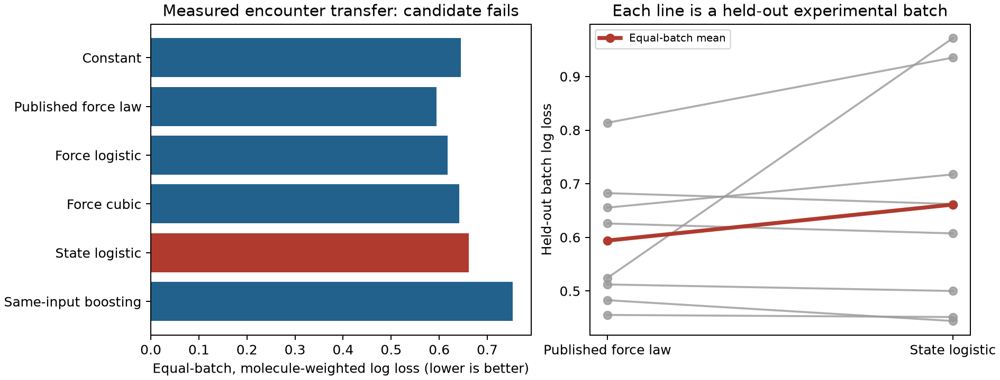

# First measured encounter-rule screen: stop the state-only candidate

**Adding loop size and elapsed extrusion time does not improve held-out
experimental-batch prediction.** Its mean log loss is 11.3% worse than the
published exponential force-law family. This is the project's first measured
single-molecule screen; it is negative evidence for this candidate, not a
breakthrough or a refutation of history-dependent biology.

## Data and frozen comparison

[Davidson, Barth, Zaczek et al. (2023)](https://doi.org/10.1038/s41586-023-05961-5)
released an [analysis archive](https://doi.org/10.5281/zenodo.7409240) containing
CTCF_overview.xlsx. The immutable archive SHA256 is
31478e8411bdbad98beb81a5c79c0c303b4a7ceffb56f809eefbccb46154ce75;
workbook SHA256 is
2b1fee0cc79bc3e319187b1f6a413b0e34e03be499f142fca7dab5e58ece9d96.
The source is CC BY 4.0. Downloaded data remain ignored; the fetcher verifies
both hashes, and result JSON retains source worksheet row numbers.

The [protocol](MEASURED_ENCOUNTER_PROTOCOL.md) was committed at **8adbf4f** before
fitting. Primary complete-case records contain 203 encounters from 167 molecule
identifiers in eight experimental date groups. The pooled 20220323_25 source
folder is kept as one group. Repeated rows share molecule weight, and every
group has equal weight. Every fit holds out a whole group. Worksheet summaries,
ambiguous/non-Boolean outcomes, wrong orientation, missing state and zero forces
are excluded by fixed rules, with counts retained in the result JSON. There
is no expansion of aggregate attempt counts into independent observations.

Write f=log(1+F/.025), t=log(1+elapsed_frames/100), l=loop_kb/10. The candidate is

    P(pass | observed state) = sigmoid(b0 + b1*f + b2*t + b3*l + b4*f*l).

Features are standardized on training groups only; the ridge penalty is fixed.
The force-only controls include linear and cubic logistic force curves, the
published functional family P(pass)=exp(-F/F0) refitted on the same training
rows, and a constant. A generic same-input boosting control guards against
calling ordinary nonlinear prediction a distinctive mechanism. This is not a
reproduction of the authors' original expanded-attempt fit or entire pipeline.

## Results

| Predictor | Primary N-side log loss | Primary Brier | Secondary N+C log loss |
|---|---:|---:|---:|
| Constant (secondary: orientation-specific) | .645079 | .224418 | .611092 |
| Published exponential force family | **.593966** | **.204738** | **.571418** |
| Linear force logistic | .617068 | .215168 | .596698 |
| Cubic force logistic | .641216 | .222882 | .616455 |
| Candidate state logistic | .661124 | .232067 | .633519 |
| Same-input histogram boosting | .753173 | .244012 | .707721 |

The primary candidate beats the exponential on five of eight groups but loses
substantially on others. Its mean loss improvement is -.067158, with a paired
whole-group bootstrap 95% interval [-.185420,.014281]. The small number of groups
and source correlations limit that interval's interpretation; it does not
establish a statistically certain disadvantage. It certainly does not support
the frozen >=10% improvement gate. The candidate also loses to the force-only
cubic on average and improves only three of eight groups against that control.

The secondary analysis has 367 rows, 296 molecules and nine groups; its loss is
10.9% worse than the exponential. Orientation is partly confounded with source
conditions, and this secondary result is not independent replication. A review
found that the initial secondary constant implementation omitted its specified
orientation offset. That control was corrected and the entire screen rerun;
primary predictions, candidate results, best control and both decisions are
unchanged. No hyperparameter or continuation-gate change was made.



## What this rules out and what it leaves open

Stop expanding this state-only logistic rule. Do not use these outcomes to
select another model on the same rows and call it a fresh confirmation.

The spreadsheet is an encounter summary, not a complete ordered event log.
Attempt counts can refer to aggregated earlier failures, and worksheet order
is not validated chronology. Blocking time and eventual passage must not be
fed into a putatively prospective predictor. Cadence may differ across batches,
and force/loop size can be retrospectively estimated from the same movie.
Thus this dataset cannot support the intended claim of learning a transferable
history-dependent interaction law. Neither successful nor failed cross-sectional
prediction identifies such a law: any conditional mean p(x) can arise either
from a memoryless Bernoulli rule or, where p is interior, a half/half hidden-state
mixture with probabilities p(x)-delta and p(x)+delta. These models agree on this
observable while disagreeing on state-conditioned responses. This is a standard
latent-mixture identification limitation, not a new theorem of neural learning.

A stronger next study needs full molecule IDs, encounter order, force/time
traces, independent loading/construct batches, censoring/end-of-movie flags and
cadence. Fit a kinetic rule using only past information and hold out complete
construct/perturbation conditions; compare to force-only, conventional hidden-
state and semi-Markov controls. Dynamic barriers already have strong precedent,
including [Rahmaninejad et al. (2025)](https://doi.org/10.1101/gr.280108.124).
The paper states full supporting data are available on request. Such a request
has not been sent and raw trajectory access is not established. Larger-system
transfer is deferred until an actual learned local rule survives this gate.

```bash
python -m pip install -r requirements.txt -r requirements-measured.txt
python study_measured_encounters.py
python plot_measured_encounters.py
python -m unittest discover -s tests -v
```

The earlier recovery theorems and simulator results remain conditional results.
This measured screen does not upgrade the broad architecture novelty claim.
