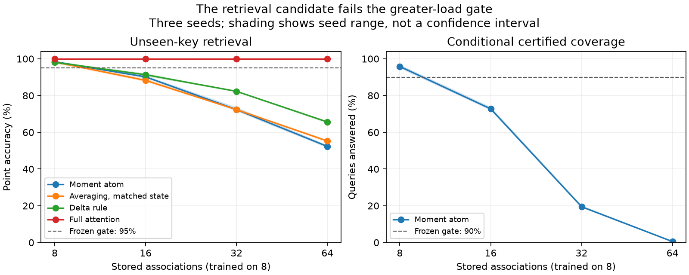

# Moment retrieval: the continuation gate failed

**The candidate does not justify an architecture advance.** It retrieves unseen
keys at the training load, loses recall when the memory load grows, and does not
show a useful quality/compute tradeoff on real causal text. The conditional
compatibility check is mathematically valid under its assumptions, but cannot
establish that a key was ever written. Scaling this variant is not supported.

## Mechanism and novelty boundary

The [protocol](MOMENT_MEMORY_PROTOCOL.md) was committed at `016e546` before these
experiments. For nonnegative unit-L2 key features phi(k), augmented value
xi(v)=(1,v), and ridge lambda>0, the update and read are

    S_t = S_(t-1) + phi(k_t) tensor xi(v_t) xi(v_t)^T
    G(q) = sum_a phi(q)_a S_(t,a) + lambda I
    d_q(v) = xi(v)^T G(q)^(-1) xi(v).

Point decoding minimizes d. Return a conditional certified answer only if exactly
one catalogue value has d<=1. If q equals a stored key, its self kernel is one.
Then G(q) contains xi(v_true)xi(v_true)^T plus PSD terms. Congruencing by G^-1/2
shows that G-xi xi^T is PSD exactly when xi^T G^-1 xi<=1. The true value therefore
survives. A unique survivor must be correct **conditional on key presence, exact
query/key alignment and a known unit write weight**. Conflicting duplicate keys
cannot be uniquely certified. The ridge loosens this necessary condition.

This is an additive lifted-feature memory using a classical inverse-moment
score, with a query-conditioned value-moment application. It is not a new
mathematical primitive. [Lasserre and Pauwels](https://arxiv.org/abs/1701.02886)
use inverse moment matrices for empirical Christoffel support estimation.
[Test-time regression](https://arxiv.org/abs/2501.12352) derives memory mechanisms
from regression objectives, including linear attention, online updates and
higher-order reads. The full-text framework was checked; novelty cannot be
claimed merely for storing statistics and solving a regression-like read.

[HOLA](https://arxiv.org/abs/2607.02303) already adds a residual-selected exact
cache to a compressive recurrent state; [Sparse Delta Memory](https://arxiv.org/abs/2607.07386)
already scales state via sparse addressing. Their full texts were inspected for
these mechanisms; neither published implementation was benchmarked here.
[Memory Caching](https://arxiv.org/abs/2602.24281),
[Variational Linear Attention](https://arxiv.org/abs/2605.11196),
[Higher-order Linear Attention](https://arxiv.org/abs/2510.27258), and
[curvature-conditioned queries](https://arxiv.org/abs/2606.01294) provide further
precedents for growing state, inverse-state updates and second-order reads;
this comparison used their abstracts. Targeted search did not find this exact
conditional atom read, but is not an exhaustive priority search. No priority or
state-of-the-art claim follows.

## Unseen keys and greater memory load

Seven supplied-binding operators, three seeds each, train on eight associations.
Train/validation/test raw keys come from separate pools; checkpoint selection uses
validation accuracy only. Values are eight 3-bit codes. Each test size contains
64 episodes. These are increasing association counts, not long-context raw-token
benchmarks. All results and pool hashes are in
[`moment_retrieval_study.json`](../results/moment_retrieval_study.json).

Mean point accuracy, percent:

| Operator | 8 bindings | 16 | 32 | 64 | Stored scalars at 32 |
|---|---:|---:|---:|---:|---:|
| Moment atom | 98.44 | 90.17 | 72.36 | 52.29 | 512 |
| Averaging, matched state | 98.31 | 88.25 | 72.35 | 55.24 | 512 |
| Averaging, same address width | 90.17 | 73.76 | 53.91 | 39.16 | 128 |
| Unit-step delta rule | 98.11 | 91.34 | 82.31 | 65.62 | 510 |
| Regularized least squares | 100.00 | 99.38 | 75.15 | 42.38 | 504 |
| Full softmax attention | 100.00 | 100.00 | 100.00 | 100.00 | 608 |
| FIFO attention, 26 bindings | 100.00 | 100.00 | 83.50 | 47.97 | 494 |

The delta control is a simplified delta-rule operator, not an official full
GatedDeltaNet reproduction. This screen is not a comparison against all current
memory architectures. Its simple controls already suffice to reject the candidate.
All operators have 257 learned parameters; fixed projection buffers are reported
separately. Moment matrices are stored in full, so 512 counts actual tensor
storage rather than only unique symmetric entries. These state counts exclude
training activations and fixed catalogue/parameter buffers. Timings are combined
operator evaluations, not isolated read/update kernels or a hardware benchmark.

Certified coverage is 95.83%, 72.75%, 19.47%, and 0.50% at the four loads. No false
certificates occurred on valid present-key tests. At 32 bindings both frozen
thresholds (95% point accuracy, 90% coverage) fail. Matched-state averaging ties
point accuracy there and exceeds it at 64; the delta control exceeds both.
Absent queries produce a singleton in **25.52%** of cases at load 16. Those
answers are outside the theorem's assumptions and must not be called certified.
Floating-point tolerance is a numerical check, not verified interval arithmetic.



## Why appending more data breaks this read

This explanatory result was developed after the failed gate, not used to choose
checkpoints. For a fixed encoder/query, each additional write adds a PSD matrix
H to G. Hence (G+H)^-1 <= G^-1 in PSD order: **every candidate's score can only
decrease, and the compatible set can only grow**. Once a query becomes ambiguous,
additional positive writes cannot restore its singleton certificate. If
lambda_min(G)>=2, every catalogue value is compatible, since ||xi(v)||^2=2 and
d(v)<=2/lambda_min(G). The argument is elementary PSD monotonicity, not a novel
general matrix theorem. It diagnoses a structural limitation of this candidate.

An exploratory nested-prefix check with frozen trained encoders queries the
first eight keys at loads 8/16/32/64. The mean compatible set grows from
1.03 to 1.36 to 3.23 to 6.89 values; at load 64 all eight values survive on
57.55% of queries. Every observed score obeys monotonicity. See
[`moment_saturation_study.json`](../results/moment_saturation_study.json).
This supports the predicted failure mode, not an improved model.

## Real causal text: no useful tradeoff established

A small Shakespeare character diagnostic uses a pinned
[corpus source](https://github.com/karpathy/char-rnn/blob/370cbcd448eb7daf32f21a6be560b70e0b33c4e3/data/tinyshakespeare/input.txt),
SHA256 `86c4e6aa9db7c042ec79f339dcb96d42b0075e16b8fc2e86bf0ca57e2dc565ed`.
Contiguous 80/10/10 splits, training-only vocabulary, context reset at 64,
600 updates, batch eight, three seeds, validation-only checkpoint selection.
Prefix-invariance tests check all four models for future-token leakage.
Keys come from the previous observed local context, with the current observed
character as its written value. This is a causal contextual-binding prototype;
the retrieval theorem says nothing about correctness of future characters.

| Model | Test nats/character, mean | Training tokens/s, mean | Parameters |
|---|---:|---:|---:|
| Moment branch + static transport | 2.117085 | 37,376 | 17,304 |
| Matched-state mean branch + static transport | 2.116259 | 42,285 | 17,304 |
| Static transport | 2.116559 | 192,592 | 16,534 |
| Causal attention | 2.120459 | 278,308 | 18,114 |

Moment and averaging branches store the same 2,048-scalar content state. Their
fixed projection buffers differ and are recorded. Test quality is essentially
unchanged while the moment prototype trains 5.15 times slower than static
transport. These unoptimized CPU measurements include tensor materialization
and solves; they are not an asymptotic or fused-kernel speed claim. The tiny
three-seed diagnostic establishes neither language-model competitiveness nor
statistical equivalence. It supplies no evidence for the desired tradeoff.
Raw metrics, split indices and every validation curve are in
[`moment_text_study.json`](../results/moment_text_study.json).

## Decision and next falsifiable question

Stop scaling this positive additive-moment variant. The original controlled
transport recovery results remain separate and unchanged. A model-architecture
novelty rating of 9/10 is not earned. This screen adds reproducible negative
evidence and a mechanism-level explanation, not a competitive replacement for
attention.

Before a replacement, answer whether content-dependent removal or redistribution
can prevent support saturation while retaining a useful present/absent-key test
at fixed measured storage. Forgetting, sparse addressing, exact caches and delta
updates already have precedents; adding one is insufficient novelty. Any candidate
needs explicit equations and a distinguishing capability, a new frozen screen
with absent keys, conflicting writes, key noise and adversarial collisions, then
fresh held-out keys at 4x/8x load against strong implementations. Only a pass
justifies learned raw-token binding, larger real-text compute curves and scaling.
No such replacement is claimed in this report.

## Reproduce

Use the repository environment, CPU torch and two threads as in the scripts.

```bash
python -m unittest discover -s tests -v
python study_moment_retrieval.py
python study_moment_saturation.py
curl -L https://raw.githubusercontent.com/karpathy/char-rnn/370cbcd448eb7daf32f21a6be560b70e0b33c4e3/data/tinyshakespeare/input.txt -o /tmp/extrusion-shakespeare.txt
python study_moment_text.py --corpus /tmp/extrusion-shakespeare.txt
```

The text script verifies the source hash. Checkpoints are provided only for the
small retrieval candidate; load trusted repository artifacts with `weights_only`.
