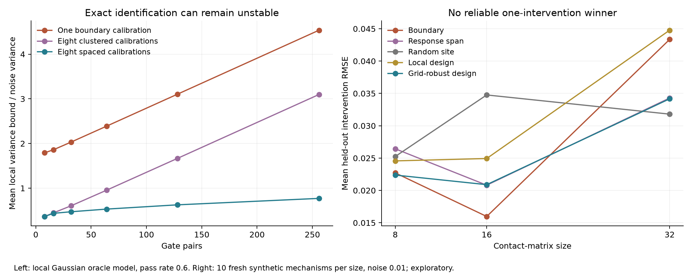

# Noisy routing: results and direction change

## Finding

Exact one-intervention identifiability does not imply stable recovery. The earlier
span-based selection advantage was measured with an exact baseline map. It does
not generalize consistently to noisy baseline contacts. A local noise-aware design
and a grid-robust variant also failed to establish a reliable winner. These negative
results motivate [calibration-budget analysis](STABLE_CALIBRATION.md).

## Experiments

Three exploratory rounds used distinct seeds. Each generated 30 mechanisms
(10 per matrix size 8, 16 and 32), tested at three absolute Gaussian noise levels:
0.001, 0.01 and 0.05. That is 90 mechanisms and 270 noisy settings in total;
noise levels within a mechanism are paired, not independent biological replicates.
Loads were uniform [0.4,0.9], gates uniform [0.4,0.7]. Both the baseline map and
single calibration observation were noisy. Selection only saw the noisy baseline.

All-map constrained least squares projected the noisy contacts onto feasible
routing operators. Two starts were compared. Direct three-band algebra, by
contrast, often failed to produce a feasible positive-gate family: at size 32,
it was feasible in only 30% of the first round's noise-0.01 cases and none of its
noise-0.05 cases. All projected families in these rounds were numerically resolved.
Projection is a point estimate; its equivalence-family range is not a confidence
set for noisy data.

First-round mean held-out local-intervention RMSE:

| Size | Noise | Boundary | Largest span | Random site |
|---|---:|---:|---:|---:|
| 8 | .01 | .02796 | .03248 | .03874 |
| 16 | .01 | .02920 | .03454 | .03906 |
| 32 | .01 | .05429 | .04165 | .03989 |

The second round added a classical local experimental-design score accounting
for baseline noise. At size 16/noise .01 it was worse than the boundary rule:
.04462 versus .02028. Evaluating that criterion at one arbitrarily fitted member
of a partially identified family can be fragile.

The third round minimized the worst local score over nine interior points of the
fitted family, and used three joint-fit starts for **every** method. This was a
fresh exploratory round, not selective rerunning of unfavorable observations.

| Size | Noise | Boundary | Largest span | Random | Local design | Grid-robust design |
|---|---:|---:|---:|---:|---:|---:|
| 8 | .01 | .02271 | .02644 | .02525 | .02457 | .02238 |
| 16 | .01 | .01597 | .02081 | .03476 | .02494 | .02089 |
| 32 | .01 | .04335 | .03429 | .03180 | .04478 | .03417 |
| 32 | .05 | .07838 | .07054 | .08354 | .07108 | .06625 |

The grid-robust method wins some conditions and loses others. It is not selected
as a proven improvement. Joint-fit starts sometimes reached different objectives
(maximum difference 0.000257), so convergence flags do not certify a global optimum.
All-site RMSE is also retained in the later round records; held-out comparisons
exclude different selected sites and should be interpreted with that limitation.
There is no multiple-comparison-adjusted performance claim.

## Why intervention budgets are the better next question

For balanced gates the contact Jacobian is spectrally comparable to a path
Laplacian. The proof in `STABLE_CALIBRATION.md` yields a length-dependent local
Cramer-Rao bound even after one calibration. This explains why removing the exact
ambiguity can leave many weakly observed directions.

At pass rate .6 and 256 gate pairs, the normalized mean local variance bound is
4.537 with one boundary calibration, 3.098 with eight clustered boundary
calibrations, and .771 with eight spread through the chain. These are information
bounds in a restricted local model, **not** measured nonlinear test errors.
A separate linearized Gaussian simulation agreed with the computed covariance
within Monte Carlo variation. The proof and 18 spectral-check settings establish
a limited stability statement, not a new general-purpose neural architecture.

## Reproduction and priority

Run `python study_noisy_identification.py`, then `--noise-aware`, then
`--robust-design`. Run `python study_calibration_budget.py` for the local bounds.
Protocols, every per-mechanism error, optimizer diagnostics and placement tables
are retained. Existing neural-task failures remain unchanged.

Constrained least squares, Fisher information, robust experimental design and
Laplacian anchoring are established methods. Relevant precedents include
[optimal experiments for partial identification](https://arxiv.org/abs/2605.06993),
[Laplacian Cramer-Rao bounds](https://arxiv.org/abs/1211.1621), and the structured
matrix work already cited in `PRIOR_WORK.md`. Priority for the extrusion-specific
reduction and its calibration scaling has not been established. A high novelty
rating still requires a distinct result beyond that prior work and evidence that
it improves learning or intervention prediction on independent tasks.
