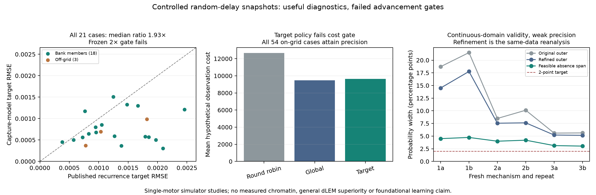

# Common-observable intervention comparison and finite-bank acquisition

**The frozen improvement gates fail.** A hidden-capture fit has 1.93-fold lower
median intervention RMSE than the mapped published dLEM recurrence across all
21 cases, below the required twofold gain. Target-disagreement acquisition costs
1.8% more than the stronger control rather than 20% less. Finite-bank envelopes
exclude the generating target in all three off-grid cases. These results do
not establish a new architecture or a generally reliable acquisition policy.

The [protocol](OCCUPANCY_PROTOCOL.md) was committed at `75e4b4a` before point
outcomes. Action rules at `1b9ce67` preceded acquisition outcomes. Complete
[point comparisons](../results/occupancy_study.json) and
[acquisition results](../results/bank_acquisition_study.json) retain all cases,
fits, counts, seeds, predictions and costs.

## An exact common-observable bridge

Load one motor at site 8 of a 17-site lattice and independently choose an
observation delay T~Exp(gamma). Record the anchor pair if it survives to T,
otherwise record absent. Every episode yields one categorical observation.
This is a controlled single-molecule experimental-design toy, not Hi-C,
polymer contact probability, or an established measured assay in this project.

For a position-Markov process with left/right rates L_i,R_j, constant removal
mu and known loading q, the resolvent gives

    C_ii = gamma*q_i/(L_i+R_i+mu+gamma)
    C_ij = [L_{i+1} C_{i+1,j}+R_{j-1} C_{i,j-1}] /
           [L_i+R_j+mu+gamma].

This is exactly the unchanged authors' [netdlem2 forward](https://github.com/chikinalab/dLEMpytorch/blob/e55f9226192c34c34990518713a15ec42dff884a/dlem/models/netdlem2.py)
after index mapping, constant=1, transform=False, a constant unloading product
representing mu+gamma, and the supplied source diagonal. The pinned PyTorch
module's left parameter drives the right anchor; its right drives the left.
A common rate rescaling keeps its mapped values within [0,1] without changing
the probabilities. The absent category is one minus total occupied mass.

The source file SHA-256 is
`35fcb75676f895d22e801520be9ae21001a172b66bcbbc2ef36ccfe17e94d290`.
It is downloaded to ignored `external/`, hash checked, loaded unchanged and
not redistributed under this repository's license. Tests compare the full
mapped operator at several rates/delays; fitted-output discrepancies are below
1e-10. NumPy optimization uses the equivalent recurrence, and comparative
outputs use the unchanged authors' implementation. This equivalence rules out
claiming the memoryless recurrence itself as an architectural distinction.

The alternative retains whether either arm was irreversibly captured on
arrival at sites 5/11. Captured arms cannot step; removal is mu*h if either is
captured and mu otherwise. An acyclic four-state-per-position flow solve gives
snapshot probabilities. This is classical Markov modeling of an existing
[lefsim](https://github.com/abdenlab/lefsim) mechanism, not new extrusion physics.
Unmodified lefsim generates the observations; independent censor clocks and
disjoint engine-seed ranges are used for calibration and target observations.

## Equal-observation point comparison

Each of 18 on-grid and three additional off-grid mechanisms has 20,000 baseline
observations at gamma=.3 and 20,000 new observations after doubling every
removal rate. Both continuous fits use exactly the same baseline categories and
known source, three fixed starts, and squared Hellinger distance. The capture
fit has four parameters; the dLEM recurrence fits all 16 effective directional
step rates plus a constant removal rate (17). This is the constant-removal
subclass admitting the stated observation-clock mapping; spatially varying
free-unloading tracks are not benchmarked. All selected fits report convergence. These are
numerical local fits, not certified global minima or the authors' complete
sequence-to-contact training pipeline. Other dLEM modules, including the
repository's stalling variant, have not been compared.

Entries are medians of probability RMSE across cases, not percentages.

| Cases | Capture baseline | Published recurrence baseline | Capture intervention | Published recurrence intervention | Target ratio |
|---|---:|---:|---:|---:|---:|
| All 21, primary | .000550 | .000748 | .000645 | .001246 | 1.93 |
| 18 on finite grid | .000516 | .000747 | .000617 | .001258 | 2.04 |
| 3 off-grid | .000638 | .000748 | .000695 | .001034 | 1.49 |
| 9 protected-state cases | .000501 | .001027 | .000578 | .001793 | 3.10 |
| 9 constant-removal cases | .000550 | .000512 | .000676 | .000829 | 1.23 |

The primary baseline-fit advantage is only 1.36-fold, within the specified
twofold limit, but the intervention gain misses its threshold. Protected-state
results alone cannot substitute for the full frozen screen. Comparing to exact
generator targets gives a 3.13-fold median ratio, a useful noise diagnostic;
the primary target was the fresh engine sample and remains 1.93-fold.
Finite-bank point fitting is given the exact generating grid for 18 cases and
must not be promoted as continuous generalization. It performs poorly off-grid.

## Finite-bank adaptive observation

The supplied bank contains 54 mechanisms. At each batch an action chooses one
of gamma=.1/.3/1/3 and adds 1,000 categorical observations, up to eight batches.
Clopper-Pearson intervals use .05/(4*8*82) per category/horizon. The union event
covers every action and scheduled cumulative sample size, so filtering remains
valid under adaptive choices **conditional on true membership in the bank**.
The intervention envelope is the range over retained candidates. Stop at .02
maximum category width or reject/abstain. This is not continuous-parameter coverage.

Global disagreement averages squared Hellinger separation of retained pairs per
quoted cost. Target disagreement maximizes the minimum separation among pairs
whose intervention predictions differ by more than .02, per cost. Quoted cost
is 1+1/gamma per episode, a hypothetical upper bound, not lab timing.

| Policy | On-grid attainment | On-grid target enclosure | Mean quoted cost |
|---|---:|---:|---:|
| Round robin | 54/54 | 54/54 | 12654.32 |
| Global disagreement | 54/54 | 54/54 | 9462.96 |
| Target disagreement | 54/54 | 54/54 | 9635.80 |

In the three off-grid cases, round robin and target disagreement both stop with
small envelopes but exclude the generating target in every case. Global
disagreement rejects two cases; its remaining envelope also excludes the target.
The membership assumption matters even when a point fit appears plausible.



## Decision and next evidence

Retain the common-observable adapter and distinguish hidden capture from a
memoryless rate model. Do not claim superiority over dLEM generally, a measured
biological advantage or a new learning paradigm. Stop the finite-bank policy's
novelty/saving claim. The [continuous-domain follow-up](CONTINUOUS_OCCUPANCY_RESULTS.md)
repairs point-grid membership handling, but useful precision remains unresolved.
Classical resolvents, set-membership inference, optimal experiment design and
active model discrimination are precedents, not newly invented concepts here.

The next study should test a genuinely obtainable kinetic/perturbation
observable and distinguish information limits from conservative computation.
Additional variants of these same toy snapshots are not evidence for a
foundational biological architecture. A fair measured-data benchmark and
comparison with additional mechanistic models remain required.

```bash
python -m pip install -r requirements.txt -r requirements-external.txt
python dlem_comparator.py
python -m unittest discover -s tests -v
python study_occupancy.py
python study_bank_acquisition.py
```
