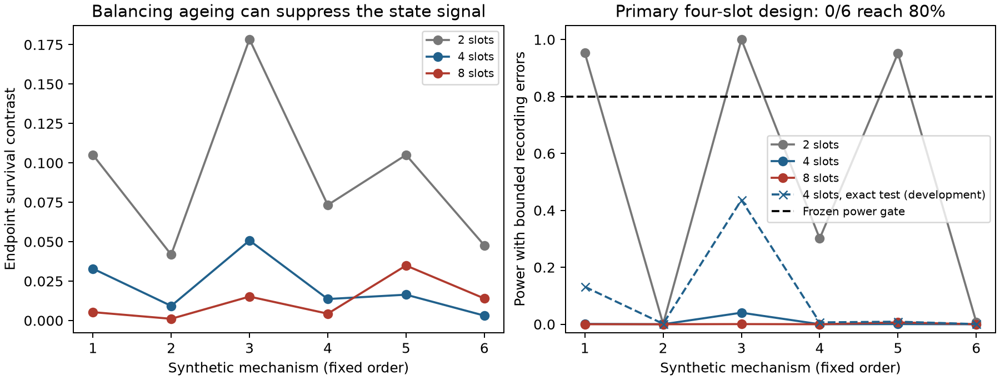

# Endpoint pulse order: nuisance cancellation costs detectable signal

**Balanced endpoint schedules cancel the specified scalar ageing/frailty null,
but fail the frozen power gate.** At 1,000 molecules per arm and up to five
wrong endpoint calls per arm, none of six primary hidden-state cases reaches
80% robust detection power. This is an experiment-design screen, not measured
biology and not a new learning architecture.

The [protocol](PULSE_ORDER_PROTOCOL.md) was committed at **2dd76b6** before the
simulator outcomes. The earlier CTCF encounter workbook is not reused. The
candidate concerns a two-state protective mechanism and proposes a way to test
for a missing state with endpoint observations, rather than fitting another
cross-sectional state logistic on previously evaluated data.

## Restricted null and exact cancellation

For a molecule z with fixed latent frailty, let its event hazard be
lambda_z(u,t)=sum_(j=0)^d c_(z,u,j)t^j, nonnegative on the experiment. The
condition u is A or B; z does not evolve in response to the schedule. Conditional
survival is exp(-integral lambda). Frailty coefficients can be arbitrarily
correlated, and the arms draw molecules from the same population independently.

Let w be the Thue–Morse word of length 2^(d+1) and compare it with its complement
in equal-duration slots. The classical Prouhet identity balances sums of slot
indices to powers 0 through d. Integrals of t^j over a slot are polynomials of
the slot index of degree j, so the two schedules have identical A and B time
moments through d. Their integrated hazard is equal for every z. Averaging
survival over ANY common frailty distribution preserves this equality. Thus:

- AB versus BA cancels constant scalar force hazards;
- ABBA versus BAAB also cancels linear force-by-age hazards;
- ABBABAAB versus BAABABBA also cancels quadratic force-by-age hazards.

This identity is classical moment balancing applied to a survival null. It
neither establishes priority for drift cancellation nor makes arbitrary ageing
indistinguishable from hidden dynamics. Equal total duration T=4 (arbitrary time units) and equal A/B
exposure are retained across schedule lengths; switch counts differ (1/2/5).
Hardware switching costs and feasible forces remain unmeasured.

## Finite-sample observation guarantee

Let n_A,n_B be independent Bernoulli endpoints and at most r_A,r_B recorded
outcomes in each arm be corrupted. Under equal true endpoint probabilities,
Hoeffding's inequality on the weighted difference gives

    P(|p_hat_A-p_hat_B| > sqrt(.5*(1/n_A+1/n_B)*log(2/alpha))) <= alpha.

Every allowed corruption changes the frequency difference by at most
r_A/n_A+r_B/n_B. Adding that amount to the threshold preserves the guarantee
for arbitrary data-dependent corruptions within the supplied counts. No
independence between the recording errors is required. At n_A=n_B=1000,
r_A=r_B=5 and alpha=.05 the threshold is .070736. The error counts are assumed,
not estimated assay error rates. This fixed-time guarantee is not an optional-
stopping confidence sequence. Choosing among multiple schedule tests would
need a separate multiplicity argument.

## Frozen screen

100 random 32-component frailty mixtures with nonnegative linear age hazards
were tested under all three schedule families. In the primary four-slot
family every exact null contrast is zero; the largest robust rejection rate
across the 100 null cases is .0005 in 2,000 experiment replicates per case.
The conservative test is substantially below its .05 ceiling in these cases.

The hidden-state alternative has unprotected/protected states, condition-
specific switching and event hazards. Rows are propagated by matrix
exponentials and independently checked by an explicit absorbing-event Gillespie
engine. Across 36 arm comparisons of 20,000 engine episodes each, maximum
endpoint discrepancy is .008492, below the .014901 simultaneous sampling
allowance. Rates are synthetic and not learned or calibrated from chromatin.

| Capture k | Protected hazard ratio h | Four-slot exact contrast | Robust power | Ideal Fisher power |
|---|---|---:|---:|---:|
| 0.15 | 0.1 | 0.032906 | 0.0010 | 0.5895 |
| 0.15 | 0.4 | 0.009272 | 0.0000 | 0.0860 |
| 0.5 | 0.1 | 0.050784 | 0.0405 | 0.8375 |
| 0.5 | 0.4 | 0.013639 | 0.0000 | 0.1420 |
| 1.5 | 0.1 | 0.016389 | 0.0005 | 0.1405 |
| 1.5 | 0.4 | 0.003114 | 0.0000 | 0.0560 |

Robust power includes worst-direction bounded corruption toward zero; ideal
Fisher uses the uncorrupted observations and is not a same-assumption winner.
The two-slot family has stronger hidden-state signals but can be biased by
linear ageing: its largest null contrast in this screen is .038228. Increasing
moment cancellation to eight slots further suppresses many useful signals.
No schedule family is selected afterward and called a successful confirmation.

## Stronger exact-test diagnostic after the screen

The [refinement protocol](PULSE_TEST_REFINEMENT.md) was committed at **437c8b0**
before these refined power outcomes. For each observed count pair, maximize the
equal-arm two-sided Fisher p-value over every pair allowed by the recording-error
budget. If their count intervals overlap, the supremum is one; otherwise it is
attained at the nearest endpoints. Equal-arm hypergeometric symmetry and the
success-count coupling prove the required monotonicity. Small-count tests check
the formula against all compatible count pairs, not an approximation.

The true uncorrupted count pair lies in the supremum set, so rejection is
conservative under every permitted corruption. This is a conventional exact
nuisance-parameter supremum, not a new testing principle or a sequential test.
Replaying the original RNG stream reproduces EVERY saved ideal-Fisher and
Hoeffding result before applying the stronger test. There are no new mechanisms
or independent confirmation data in this diagnostic.

Four-slot robust exact-test powers are .1315, .0015, .4365, .0065, .0090 and
.0005 in the table's order. The maximum null rejection rate is .0525 across
100 cases of 2,000 Monte Carlo replicates; that estimate can fluctuate above
.05 although the exact null test has size at most .05 under its assumptions.
**Still 0/6 reaches .80 power.** The failure is not solely the Hoeffding bound,
but no universal information-theoretic power limit is claimed.



## Counterexamples and decision

A scalar quadratic-age hazard with no evolving latent state gives four-slot
survivals .490008 and .598497. It lies outside the primary linear-age null and
could falsely be called memory if that restriction were omitted. The eight-
slot schedules cancel this example. Conversely, two noncommuting hidden-state
generators with equal event hazards across their hidden states give identical
endpoint survival (.060810) under every tested schedule. Hidden-state existence
is not equivalent to endpoint observability.

Stop the claim that this primary design efficiently detects the tested hidden
states under the stated observation errors. An exploratory common A/B readout
suffix (durations .25/.5/1/2, using the six development mechanisms) also failed
to produce a uniformly strong contrast; this was NOT another confirmation or
part of the frozen gate. Do not expand this endpoint-only prototype into a
supposedly new neural architecture.

A stronger route needs an observable that distinguishes the candidate internal
states—e.g. independently measured barrier engagement plus event timing—and
an assay error calibration, followed by held-out perturbations. The public
encounter summaries do not supply those observations. No lab timings, device
control or biological experiment is claimed here.

A subsequent [data-feasibility audit](TRAJECTORY_DATA_FEASIBILITY.md) found
public live-cell locus trajectories from two independent studies and verified
small pilot files. This supplies a route to temporal prediction studies without
first obtaining lab access. Those data do not directly label motor engagement
or validate the proposed pulse experiment; fitting has not started.

## Prior work and scope of novelty

Single-molecule static/dynamic disorder already has substantial theory and
experimental evidence ([Directly measuring single-molecule heterogeneity](https://pmc.ncbi.nlm.nih.gov/articles/PMC4941464/)).
ABBA drift removal is standard metrology ([NIST](https://itl.nist.gov/div898/handbook/mpc/section3/mpc3312.htm));
polynomial drift and statistical costs were studied by
[Swanson and Schlamminger](https://arxiv.org/abs/1009.1894). Thue–Morse driving,
noncommuting dynamics and pulse cancellation are established, including
[Thue–Morse heating-rate bounds](https://arxiv.org/abs/2101.07065). No priority claim follows from
failing to find the exact biological application in a search. The contribution
is this explicit null, bounded-recording-error test, matched-duration screen
and counterexamples; its broad architecture novelty remains unestablished.

```bash
python study_pulse_order.py
python plot_pulse_order.py
python -m unittest discover -s tests -v
```
